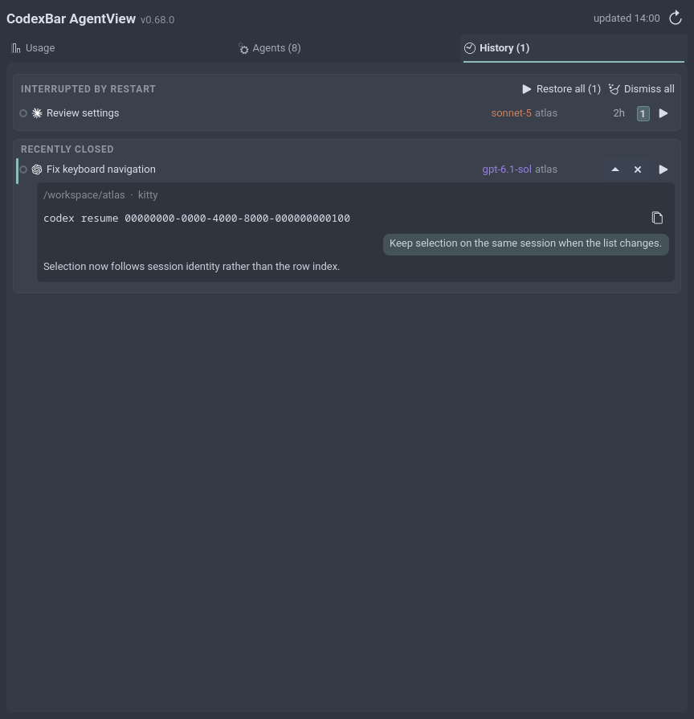
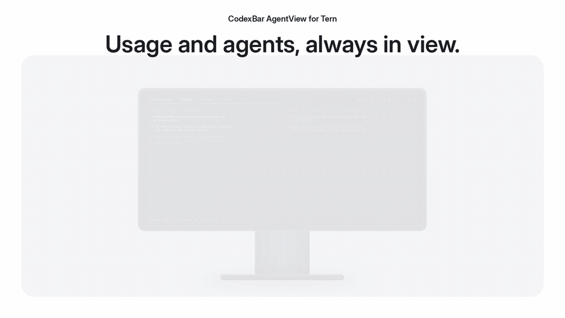
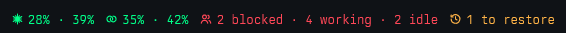
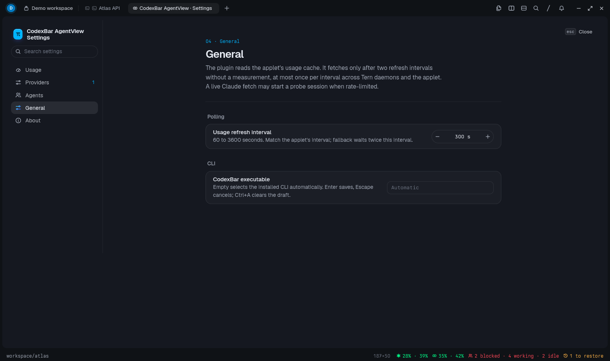

# CodexBar AgentView

AI provider usage and your running coding agents, in one place. It comes in two
interfaces:

- A **KDE Plasma 6 widget** puts usage rings and agent counts in your panel,
  with a popup for Usage, Agents and History and a global shortcut.
- A **Tern extension** runs on Linux and macOS. It puts usage and agent counts
  in Tern's status line and opens the same three tabs as a temporary sidebar.

What you get:

- **No surprise limits.** Every account's usage in one place, with pace
  ticks and projections that warn you before a limit hits, not after.
- **Who needs you, at a glance.** Panel dots or Tern's status line count
  working, blocked and idle agents, so a session waiting for input finds you.
- **Find any session by typing.** Every Claude Code, Codex, OpenCode, pi
  and omp session in a terminal or T3 Code, filtered as you type, with a peek
  at its last messages.
- **Jump straight to it.** In Plasma, one click switches to the right desktop
  and raises the session's terminal. In Tern, `Enter` shows its pane.
- **Never leave the keyboard.** `Super+A` in Plasma or `Ctrl+Alt+A` in Tern
  opens the agent list. Type to filter, `↑`/`↓` to select, `Space` to peek,
  `Enter` to jump.
- **Get it all back.** After a reboot or crash, **Restore all** reopens your
  kitty sessions in their own windows and your Tern sessions as tabs. Closed
  one by mistake? Bring it back from History with one click.
- **Set sessions aside without losing why.** Park a session with one
  sentence about what it waits for: a time, a GitHub pull request or release,
  a command, a job, anything else you name, or "when I have time". Code watches the wait, sends the
  session its follow-up prompt when it fires, and tells you what happened
  while you were away.

Use either interface, or both. 

It started as a Linux port of the macOS
[CodexBar](https://github.com/steipete/CodexBar) menu-bar app and uses its
`codexbar` CLI for usage data. It is an independent project, not an official
CodexBar module.

[Plasma widget](#kde-plasma-widget) · [Tern extension](#tern-extension) ·
[Install](#install) · [Shortcuts](#keyboard-shortcuts) ·
[Features](#features) · [Providers](#supported-providers) ·
[Agents](#supported-agent-sessions) · [Credentials](#provider-credentials) ·
[Update](#update)

## KDE Plasma widget


<details>
<summary>Screenshots</summary>

[](docs/panel.png)

| Usage | Agents | History |
| :---: | :---: | :---: |
| [](docs/plasma-usage.png) | [](docs/plasma-agents.png) | [](docs/plasma-history.png) |

</details>

## Tern extension



<details>
<summary>Screenshots</summary>



| Usage | Agents | History | Settings |
| :---: | :---: | :---: | :---: |
| [](docs/tern/usage.png) | [](docs/tern/agents.png) | [](docs/tern/history.png) | [](docs/tern/settings-general.png) |

</details>

The films and screenshots use made-up accounts and sessions.

## Requirements

The Plasma widget needs Linux and KDE Plasma 6. The Tern extension runs on
Linux and macOS. Windows is not supported, since there is no `codexbar` CLI
for it.

| Requirement | Plasma | Tern | Enables |
| --- | :---: | :---: | --- |
| KDE Plasma 6 with KWin | Required | | The widget |
| [Tern](https://stencil.so/tern) 0.9.9 or later | | Required | The extension |
| Python 3.10+ | Required | Required | The shared helpers |
| [`codexbar`](https://github.com/steipete/CodexBar) CLI | Required | Required | Usage. Agents and History work without it; with Meridian, so do Claude and Codex seats |
| [Meridian](https://github.com/rynfar/meridian) | Optional | Optional | Claude accounts and ChatGPT seats read from its usage poll |
| CMake 3.21+, C++17 compiler, Qt 6 QML headers | Required | | Building the widget (Arch: `base-devel cmake qt6-declarative`) |
| `qdbus6` | Optional | | Click to focus and desktop switching |
| kitty or Tern | Optional | Optional | Launch and Restore all; with both, Teleport to Tern |
| kitty remote control | Optional | Optional | Exact focus of kitty windows |
| `notify-send` | Optional | | Usage and waiting-for-input alerts |
| [`gh`](https://cli.github.com), logged in | Optional | Optional | Pull request waits |
| [omp](https://github.com/can1357/oh-my-pi) | Optional | Optional | `/wait`, the row above the composer and prompt delivery for set-aside sessions |

## Install

### Plasma widget

1. Build and install. The package has a small native QML plugin, so build it
   on the machine that runs it:

   ```sh
   git clone https://github.com/materemias/codexbar-agentview
   cd codexbar-agentview
   cmake -S . -B build
   cmake --build build
   kpackagetool6 -t Plasma/Applet -i build/package
   ```

2. Right-click the panel → **Enter Edit Mode** → **Add Widgets…**, search for
   **CodexBar AgentView** and drag it onto the panel.
3. In the widget's settings, open **Agents** and click **Install**, then run
   `systemctl --user restart plasma-plasmashell.service` once. Agents and
   History stay empty until you do.
4. [Add credentials](#provider-credentials) for providers beyond Claude and
   Codex.

The `codexbar` path defaults to `/usr/bin/codexbar`, where Arch's
`codexbar-cli` package puts it. Change it in Settings → Backend.

### Tern extension

From the repository root:

```sh
tern plugin link tern
```

Keep the checkout in place while the extension is linked; it runs its helpers
from there.

On macOS:

- Install Tern, Python 3.10+ and the CodexBar CLI, then link as above.
- The extension finds Python and `codexbar` in both Homebrew prefixes, even
  when Tern starts from Finder with a short `PATH`.
- Claude usage needs the unlocked desktop session, because the CLI reads
  Claude's token from the login Keychain.
- Restores open on the current desktop.

### omp extension (set-aside sessions)

The extension gives omp the `/wait` command and the `waitingfor` agent tool,
draws the row above the composer and delivers wait prompts. On Linux the
Plasma **Install** button links it; anywhere else, run the Tern palette
command `CodexBar AgentView: Install omp extension` or:

```sh
python3 contents/scripts/install_integration.py --omp-extension
```

It links `~/.omp/agent/extensions/codexbar-waitingfor.ts` (under
`$PI_CODING_AGENT_DIR` or `$OMP_AGENT_DIR` when set) to the checkout. omp loads extensions at start, so
run `/restart` in sessions that were already open. `--omp-extension
--uninstall` removes the link.

## Keyboard shortcuts

| Key | Action | Where |
| --- | --- | --- |
| `Super+A` | Open the popup on Agents | Plasma |
| `Ctrl+Alt+A` / `Ctrl+Alt+U` / `Ctrl+Alt+W` | Toggle the dashboard on Agents / Usage / Waiting | Tern |
| `Ctrl+Alt+B` | Set the focused session aside (in omp outside Tern too) | Tern, omp |
| `Ctrl+Alt+I` | Show or hide the focused session's card (in omp outside Tern: its details above the composer) | Tern, omp |
| `←` / `→` | Switch tabs | Both |
| `↑` / `↓` | Select a row on Agents, Waiting or History | Both |
| `Space` | Peek at the selected session; while filtering, types a space | Both |
| `Enter` | Agents: jump to the session. History: launch it. Waiting: open or resume it | Both |
| `Shift+Enter` | Agents and Waiting: open the selected session's card | Tern |
| `Tab` | Hide or show sessions idle for over a day | Both |
| `Delete` | Dismiss the selected History row; Waiting: mark it done | Tern |
| `+` | Waiting: snooze the selected wait by a day | Tern |
| `R` | Refresh (Usage tab) | Both |
| Typing | Filter Agents, Waiting and History | Both |
| `Esc` | Clear the filter, keeping the selected session, then close | Both |

KDE binds `Ctrl+Alt+A` to Activate Window Demanding Attention. Clear it in
System Settings → Shortcuts → KWin, or Tern never sees the key.

## Features

### Usage

- **Meters per provider.** Bars with percent used and reset countdown. Balance
  providers (OpenRouter, Kilo, TypeSafe) show what is left instead. A Claude
  window nobody has used since its reset reads `not started · resets 5h after
  first use`: Anthropic starts the next window on the first message.
- **Pace.** Each bar has a tick where even use would sit right now, and the
  reset line adds `proj N%`, the usage at reset if the current rate holds.
  Bars stay green while you are behind the tick, whatever the percentage.
  Four hours into a 5h window the tick is at 80%, so 79% is green, 81% yellow,
  87% orange and 94% red.
- **Several Codex accounts.** One card, one row per account, and a combined
  bar that pools them in Plus allowances (Pro counts as 20).
- **Several Claude accounts.** One card with a row per account, email and
  plan (Claude Team, Claude Max 5x), one for each Meridian profile, and
  combined 5h and 7d bars that pool them in Pro allowances (Max 5x and Team
  seats on the 5x tier count as 5, Max 20x as 20).
- **Recent usage.** 7d bars highlight what the last 24 hours used, 5h bars the
  last hour, e.g. `13% in last 24h`.
- **Saved resets.** Claude and Codex show unused reset credits and when the
  soonest expires.
- **omp rotation.** When omp's `sub-rotate` extension rotates Claude
  (Meridian profiles) or Codex accounts, the card header shows its operating
  mode and rule (`omp · auto FILL`), and each account is marked 🟢 open or
  🔒 closed. Read from `~/.omp/agent/sub-rotate/{meridian,codex}-state.json`;
  without a state file nothing is shown.
- **Codex reset forecast** from [codex-reset.com](https://codex-reset.com):
  announced, likely with a chance, or unknown with how long it has been.
- **Last known.** When a refresh fails, the last reading stays, muted and
  marked with its time. A single failed Meridian poll on a reading under
  10 minutes old shows no error, since Meridian retries on its own.
- **Warnings.** A desktop alert at 80% and 95%, or earlier when the pace says
  the window runs out before it resets. Plasma only.

### Agents

- **Live sessions,** grouped by project folder, newest first, with model,
  terminal and time in the current state. Working is a pulsing green dot,
  blocked on your input a red diamond, idle a grey ring.
- **Filter by typing.** Title, prompt, folder, provider, model and recent
  messages. Separate words with spaces: each must match somewhere, in any
  order, and each match is highlighted. Word starts work too: `fmh` finds
  "Fix MCP history" and `autor` finds "Auto-Research", but only across
  neighbouring words.
- **Peek** at the last eight turns, laid out like a chat, and the agent's
  latest recap (omp and Claude Code write them).
- **Focus.** Plasma switches desktop and raises the terminal. Tern shows the
  pane, a kitty window or a T3 Code thread.
- **Teleport to Tern.** Moves an idle kitty session into a new Tern tab.
- **Hide old sessions** idle for over a day with `Tab` or the eye switch
  (in Tern, the eye at the end of the filter field).
  Working and blocked sessions always stay.
- **Desktop badges** and a ring on the session in the window you last focused.

### History

- **Interrupted by restart.** Every session that was running before the last
  reboot, in desktop order, until it runs again. **Restore all** brings them
  back one by one: kitty sessions on their saved desktop, Tern sessions as
  tabs.
- **Recently closed.** The last 100 sessions that exited since boot, each with
  **Launch** and a copyable resume command. omp and Claude Code sessions that
  closed while nothing watched, or before you installed this, come from their
  prompt history (`~/.omp/agent/history.db`, `~/.claude/history.jsonl`) while
  their transcript and folder exist and no process runs them; they launch in
  Tern when it is installed, else kitty. Claude Code deletes transcripts after
  30 days by default (`cleanupPeriodDays`), so older sessions don't come back.
  A dismissed session stays gone until you use it again.

### Waiting (set-aside sessions)

For sessions you leave and come back to later. Each one gets your own
sentence about why you left it, what it waits for, and a history of what
happened since.

- **Set aside.** `Ctrl+Alt+B` or `/wait` opens one menu, the same in Tern and
  in omp: this session's waits with Done and +1 day, then what the session
  waits for, your sentence and, optionally, a prompt to send when it fires;
  then it parks the pane. Each item shows the one-line command that does the
  same. Shell panes in Tern get a shorter picker of their own.
- **The commands.** Type `/wait ` for completions; `/wait help` shows them
  above the composer.

  | Command | Waits for |
  |---|---|
  | `/wait 2d <sentence> [-- prompt]` | a while (`3h`, `1h30m`, `1w`) |
  | `/wait 2026-11-07 09:00 <sentence> [-- prompt]` | a date and time, or just `18:00` |
  | `/wait gh pr [N\|URL] [ready\|review\|merged\|released\|activity] <sentence> [-- prompt]` | a pull request: the default `ready` means checks green, a bot reviewed the latest push and no open thread; `activity` is the next comment, review, merge or close from anyone else |
  | `/wait gh babysit [N\|URL] [sentence]` | a bot review; then the agent fixes what's real, and the wait follows the PR to ready and merged |
  | `/wait gh release [owner/repo] <sentence> [-- prompt]` | a repo's next GitHub release, checked hourly |
  | `/wait check [every 10m] <command> [-- prompt]` | a command that exits 0, run without a shell every 15 minutes by default |
  | `/wait for <what>` | anything else; you mark it done |
  | `/wait later [S\|M\|L] <sentence>` | the time you have for it; pins the session |
  | `/wait list`, `/wait done [w1]`, `/wait note <text>` | the session's waits, closing one or all, your sentence |

  Without a PR number, `gh pr` and `gh babysit` take the PR the agent last
  named, else the current branch's; `gh release` takes the current repo. A
  shell job in Tern can also wait for the job to end, closing the pane on
  success if you like. Any wait can have a deadline (CLI and agent tool),
  after which it comes back to you while still being watched.
- **Follow-up prompts.** A wait can carry a prompt (`/wait 2d retry the
  migration -- Run the migration again and report`). When it fires, the omp
  extension sends it into the session, parked or not, after the running turn.
  A prompt can have a check (a command or PR state) that decides whether the
  turn did its job; without one, the wait comes back as "ran, take a look". A
  closed session never restarts by itself: Resume reopens it and then sends
  the prompt.
- **The agent can add waits too,** for example after opening a PR, through
  the `waitingfor` tool. It never overwrites your sentence; its suggestion
  waits for you to accept it.
- **The Waiting tab** (`Ctrl+Alt+W`) groups sessions by who has the next
  step: on me, machine watching, waiting on something, when I have time. Space
  shows the sentence, the history, the next step, the recap and the session's
  pull requests; Enter opens the session in its own tab, or resumes a closed
  one; `+` snoozes a day; Delete marks it done; `Shift+Enter` opens its card.
- **When I have time** lists every session pinned with omp's `/pin`, closed
  ones too, sorted by the size you gave it. Setting a session aside for when
  you have time pins it, and Done unpins it. It never notifies.
- **Pull requests of a session.** The ones it created (`gh pr create` or
  omp's GitHub tool), the ones it waits for, and the last five mentioned in
  the conversation, with title, state, review and checks.
- **On the pane.** A row above the omp composer
  (`⏳ PR#42 · review on head · 2d · "fix, merge, release"`, `●` when it's
  back on you), a status line segment and a yellow tab while it needs you.
  `/wait` answers in the same place, under the row, until your next input.
  The first time you focus a session whose wait fired, a card in the pane's
  corner shows your sentence, what happened since and the next step. The same
  card opens for any omp session with `Ctrl+Alt+I` (`Session card`), a
  click on the row above the composer or on the status segment, or the Card
  button (`Shift+Enter`) on Agents and Waiting, with the folder, branch,
  model, pull requests, waits and schedules; focus it to use its buttons and
  links.
- **Repeating prompts** from your own `/schedule` extension
  (`~/.omp/agent/schedule/`) show as `↻ every 2h · next 16:00` beside the
  session's waits in its status, tooltip and card. The row above the omp
  composer leaves them out, because omp-schedule draws its own.
- **Plasma** shows the waits only with Settings → Agents → **Tern
  integration** on: an hourglass on waiting rows (`●` when one is back on
  you, its line in the tooltip) and an amber count beside the panel dots.
- **tern-awui** shows the same groups on the phone, with +1 day, Done and push
  notifications when a session comes back to you.

PR waits read GitHub through `gh` every 3 minutes (15 while rate limited or
waiting for a release). The review bots are Greptile, Macroscope, CodeRabbit,
Codex, Copilot, Gemini, Cursor Bugbot, Sourcery and roboomp; pass `--bots` to
the CLI for others. A review counts when a bot finished on the latest push and
no bot's check still runs. Ready also goes ahead 15 minutes after a push that
no bot reviews, since Copilot and Codex don't review every push by default.
Everything goes through `contents/scripts/codexbar_waiting.py`,
which keeps its state in `waiting.json` and `waiting_view.json` in the state
folder.

### Panel (Plasma)

Usage rings per provider and window, coloured by pace, which you can set to
appear only once a window is projected to run out. Coloured dots count
working, blocked and idle agents. The popup opens on Agents when one is
blocked and on History when sessions wait to be restored.

With several Claude or Codex accounts, the tray settings list each account
with its own windows. A meter picked before the accounts were known (saved as
`claude:primary`) shows every account's window until you change one account,
which turns it into one meter per account
(`claude:<email>:primary`).

### Tern specifics

The dashboard opens to the right of your rightmost pane and closes when you
focus anything else, putting the layout back as it was. Palette commands
`CodexBar AgentView: Agents`, `Usage`, `Waiting`, `History`, `Settings`,
`Set aside…` and `Install omp extension` cover what the
keys do not. Settings, also at the right of the dashboard's status bar,
opens a native tab with search; **Include non-Tern agents** (off by default)
adds kitty, VS Code and other hosts. Desktop notifications and the panel are
Plasma-only.

## Supported providers

These are the providers I use and have tested. Others the CodexBar CLI
supports on Linux are usually easy to add.

| Provider | Auth | Shows |
| --- | --- | --- |
| Claude | OAuth: Meridian profiles, else `~/.claude` | 5h and 7d per account, plus Claude Design and Daily Routines |
| Codex | OAuth (`~/.codex/auth.json`), plus Meridian's ChatGPT seats | 5h and weekly per account, plus Reserve 7d |
| z.ai | `ZAI_API_KEY` | 5h and monthly |
| OpenCode Go | `apiKey` in config | 5h, 7d and monthly |
| OpenRouter | `apiKey` in config | Balance; a bar when the key has a limit |
| Kilo | `apiKey` in config | Credit balance |
| TypeSafe | `cookieHeader` in config; off by default | Credit balance |

## Supported agent sessions

Claude Code, Codex CLI, OpenCode, pi and omp, found by scanning processes and
reading their session files. No daemon or agent hooks are needed.

Sessions show up in kitty, Tern, Konsole, WezTerm, Alacritty, Ghostty, foot,
GNOME Terminal, Tilix, Yakuake, xterm, tmux, VS Code and T3 Code. A process
whose session cannot be identified is listed as untracked. Some sessions stay
off the list on purpose: Claude Code's agent view tasks, which run under
`claude daemon`, and omp or pi driven by another program (`--mode rpc`/`json`).

Focusing a T3 Code session opens its thread. This needs T3 Code 0.1 or later;
older versions only raise the window.

## Provider credentials

Plasma does not see keys exported in your shell profile, so put them in
`~/.codexbar/config.json`, which the `codexbar` CLI reads:

```json
{
  "version": 1,
  "providers": [
    {"id": "codex", "enabled": true, "codexProfileHomePaths": ["~/.codex-pro"]},
    {"id": "zai",   "enabled": true, "apiKey": "<from https://z.ai/manage-apikey/apikey>"},
    {"id": "opencodego", "enabled": true, "apiKey": "<your opencode-go key, see ~/.local/share/opencode/auth.json>"},
    {"id": "kilo",  "enabled": true, "apiKey": "<from app.kilo.ai>"},
    {"id": "openrouter", "enabled": true, "apiKey": "<management key from https://openrouter.ai/settings/keys>"},
    {"id": "typesafe", "enabled": true, "cookieSource": "manual", "cookieHeader": "<Cookie: header copied from https://console.typesafe.ai/settings/billing>"}
  ]
}
```

Then `chmod 600 ~/.codexbar/config.json`.

- **More Codex accounts.** Log in to a separate home with
  `CODEX_HOME=~/.codex-pro codex login` and list it in `codexProfileHomePaths`.
  A running Meridian's ChatGPT seats are added too (see [Meridian](#meridian)).
- **More Claude accounts** come from Meridian profiles, in this order:
  1. A running Meridian's local API (`127.0.0.1:$MERIDIAN_PORT`, default
     3456). It already polls Anthropic's usage endpoint, which rate-limits
     per access token, so the widget reads usage from Meridian. Meridian 1.87
     and later also list saved resets; with an older one the widget asks
     Anthropic for them at most once an hour per account.
  2. If Meridian is not answering, the CLI runs once per login directory in
     `~/.config/meridian/profiles.json`, with `CLAUDE_CONFIG_DIR` set to it.
  3. Without profiles, the single login in `~/.claude`, or
     `CLAUDE_CONFIG_DIR` when set.
- **OpenRouter** needs a management key; a plain inference key gets HTTP 403
  on the credits endpoint.
- **TypeSafe** (CLI 0.64.0+) has no API. On Linux, copy the `Cookie:` header
  of a signed-in billing page request from your browser's dev tools. Paste a
  fresh one when the row says the session expired.

## Meridian

[Meridian](https://github.com/rynfar/meridian) is optional. Every Claude fact
the widget shows (accounts, usage, saved resets, email and plan) comes from a
running Meridian first, then from the login directory, and only then from
Anthropic or the `codexbar` CLI. Meridian already polls Anthropic's usage
endpoint, which rate-limits per access token, so reading its copy keeps the
widget from competing with it.

Set `MERIDIAN_PORT` (default 3456) and, when Meridian requires one,
`MERIDIAN_API_KEY` in the environment Plasma or Tern starts with.

| Meridian | `codexbar` CLI | Claude | Codex | Other providers |
| --- | --- | --- | --- | --- |
| Running | Installed | From Meridian | CLI accounts plus Meridian's ChatGPT seats; the CLI's reading wins for an account both know, since it carries Reserve and saved resets | From the CLI |
| Running | Missing | From Meridian | Meridian's ChatGPT seats | "CLI not found" |
| Stopped | Installed | The CLI once per login directory | From the CLI | From the CLI |
| Stopped | Missing | Last-known usage, with one error naming both | Last-known usage | Last-known usage |

### Compatibility

| Meridian | What the widget reads from it |
| --- | --- |
| 1.87.0+ | Everything below, plus saved resets (`bankedResets`): the widget makes no Anthropic call for Claude |
| 1.83.0 – 1.86.x | Claude profiles with usage, email and plan, and ChatGPT seats (added in 1.83.0) as Codex accounts. Saved resets come from Anthropic, at most once an hour per account |
| Older | Untested. Claude profiles may work; a field Meridian does not send comes from the login directory |

Tested live with 1.85.0; ChatGPT seats are tested only against Meridian's
documented response shape. A Meridian without profiles serves the local
`~/.claude` login, which the widget shows as one account.

## Settings

Each interface keeps its own settings. Right-click the widget → **Configure
CodexBar AgentView**, or run `CodexBar AgentView: Settings` in Tern. Usage
warnings are on by default and waiting-for-input alerts off.

## Update

Plasma widget. Stop Plasma before replacing the native plugin;
`systemctl --user stop` waits for plasmashell to exit, `kquitapp6` does not:

```sh
git pull
cmake -S . -B build && cmake --build build
systemctl --user stop plasma-plasmashell.service
kpackagetool6 -t Plasma/Applet -u build/package
systemctl --user start plasma-plasmashell.service
```

If an update deleted files, replace the `-u` line with
`kpackagetool6 -t Plasma/Applet -r io.github.materemias.codexbaragentview`
followed by `kpackagetool6 -t Plasma/Applet -i build/package`.

Tern extension. Close any open dashboard first so it can restore your layout:

```sh
git pull
tern plugin reload
```

<details>
<summary>Upgrading from codexbar-kde</summary>

The widget ID, Tern plugin ID and URL handler changed with the rename.
Sessions, history and the usage cache move to
`~/.local/state/codexbar-agentview/` the first time a helper runs;
`~/.codexbar/config.json` stays.

Point the existing panel widget at the new package so it keeps its place and
settings:

```sh
git pull
cmake -S . -B build && cmake --build build
systemctl --user stop plasma-plasmashell.service
kpackagetool6 -t Plasma/Applet -i build/package
sed -i 's/^plugin=org\.codexbar\.plasmoid$/plugin=io.github.materemias.codexbaragentview/' \
  ~/.config/plasma-org.kde.plasma.desktop-appletsrc
kpackagetool6 -t Plasma/Applet -r org.codexbar.plasmoid
systemctl --user start plasma-plasmashell.service
```

Then click widget settings → **Agents** → **Install** again. Relink the Tern
extension; it copies its old settings on first start:

```sh
tern plugin unlink codexbar
tern plugin link tern
```

</details>

## Uninstall

Click Settings → Agents → **Remove** if you installed the integration, then:

```sh
kpackagetool6 -t Plasma/Applet -r io.github.materemias.codexbaragentview
tern plugin unlink codexbar-agentview
```

## Development

Build and test with `cmake -S . -B build -DCODEXBAR_BUILD_TESTS=ON`,
`cmake --build build` and `ctest --test-dir build`. Re-render the films with
`uv run film/take_kde.py && uv run film/compose.py kde`, or `take_tern.py` and
`compose.py tern`; the Tern take opens a window on a scratch daemon for about
a minute.

## License

MIT. See [`LICENSE`](LICENSE). Provider logos under `contents/icons/` are
trademarks of their owners, used only to identify them. See
[`NOTICE`](NOTICE).
