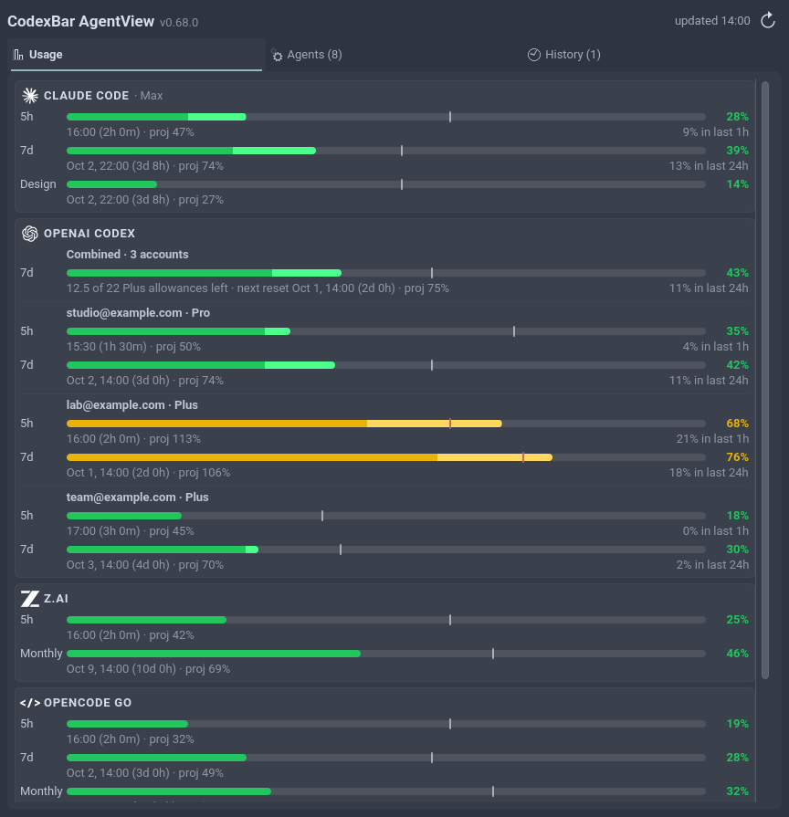
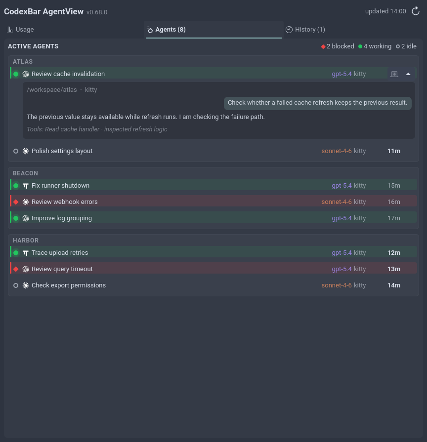
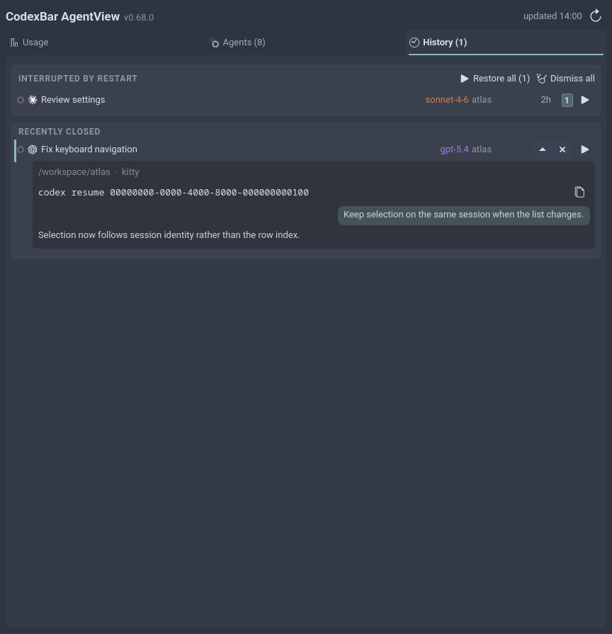
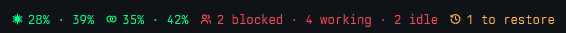
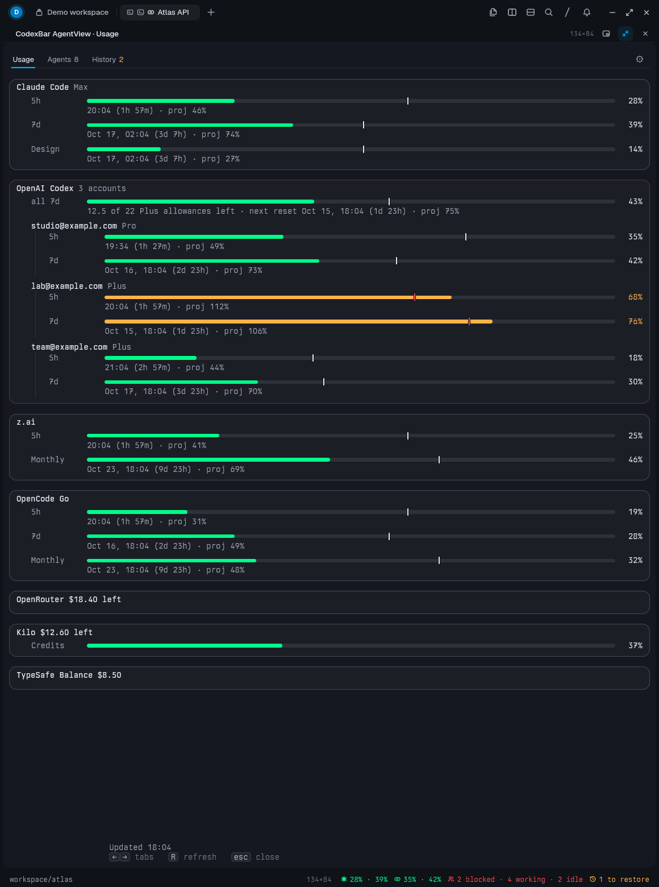
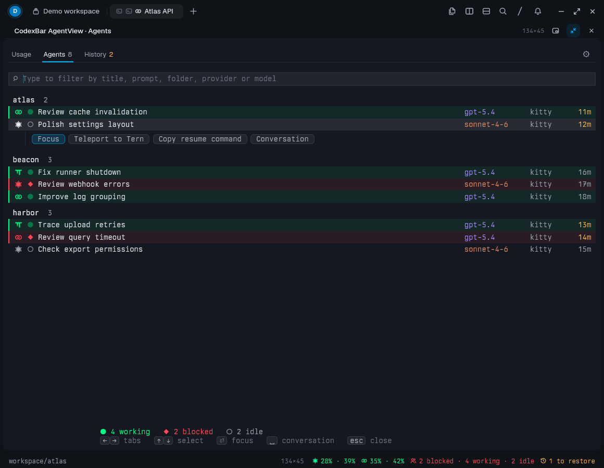
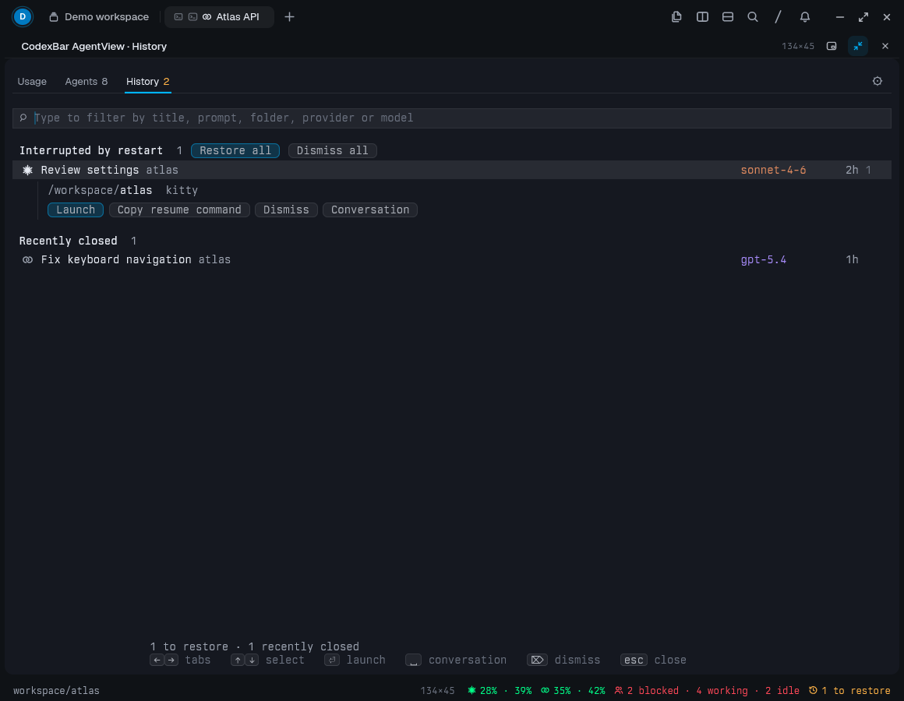
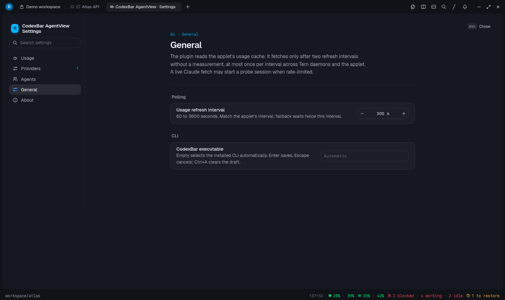

# CodexBar AgentView

CodexBar AgentView shows AI provider usage and coding-agent sessions through two
interfaces:

- A **KDE Plasma 6 widget** puts usage rings and agent counts in your panel,
  with a popup for Usage, Agents and History and a global keyboard shortcut.
- A **native Tern extension** runs on Linux and macOS. It puts usage and agent
  counts in Tern's status line, opens the same three tabs as a temporary sidebar,
  and has its own native settings tab.

Use either interface on its own, or both together. The Tern extension does
not require building or installing the Plasma widget, and it does not use
KWin or any other KDE service. Both use the same Python helpers, provider
usage cache and session snapshot in `~/.local/state/codexbar-agentview/`.
The extension reuses fresh usage measurements from the widget and fetches
only when they are missing or stale.

Each interface keeps its own display settings. Provider credentials in
`~/.codexbar/config.json`, the file the `codexbar` CLI reads, are shared.

- **No surprise limits.** Every account's usage in one place, with pace
  ticks and projections that warn you before a limit hits, not after.
- **Who needs you, at a glance.** Panel dots or Tern's status line count
  working, blocked and idle agents, so you see a session waiting for input
  without looking for it.
- **Find any session by typing.** Every Claude Code, Codex, OpenCode, pi
  and omp session running in a terminal or T3 Code, filtered as you type, with a peek at
  its last messages.
- **Jump straight to it.** In the Plasma widget, one click switches to the
  right desktop and raises the session's terminal, whichever monitor it is
  on. In Tern, `Enter` shows the session's pane.
- **Never leave the keyboard.** `Super+A` in Plasma or `Ctrl+Alt+A` in Tern
  opens the agent list, typing fuzzy-finds a session, `↑`/`↓` select it,
  `Space` peeks and `Enter` jumps to it.
- **Get it all back.** After a reboot or crash, **Restore all** reopens your
  kitty sessions, each in its own window, and your Tern sessions as tabs.
  Closed one by mistake? Find it in History and bring it back with one click.

It started as a Linux port of the macOS
[CodexBar](https://github.com/steipete/CodexBar) menu-bar app and uses its
`codexbar` CLI for usage data.
This is an independent project, not an official CodexBar module.

[KDE Plasma widget](#kde-plasma-widget) · [Tern extension](#tern-terminal-extension) ·
[Requirements](#requirements) · [Install](#install) ·
[Keyboard shortcuts](#keyboard-shortcuts) ·
[Features](#features) · [Supported providers](#supported-providers) ·
[Supported agents](#supported-agent-sessions) ·
[Credentials](#configure-provider-credentials) · [Configuration](#configuration) ·
[Update](#update)

## KDE Plasma widget

The panel shows usage rings per provider and window, coloured by pace, and
dots counting working, blocked and idle agents. Clicking it, or `Super+A`,
opens the popup.

[](docs/panel.png)

| Usage | Agents | History |
| :---: | :---: | :---: |
| [](docs/plasma-usage.png) | [](docs/plasma-agents.png) | [](docs/plasma-history.png) |

The screenshots use made-up accounts and sessions. Drag the popup's edges
to resize it within the available screen space.

## Tern terminal extension

Tern's status line shows Claude and Codex usage and the agent counts in
every window. Clicking a segment, `Ctrl+Alt+A` or `Ctrl+Alt+U` opens the
dashboard as a temporary sidebar. Details are under [Tern plugin](#tern-plugin).



| Usage | Agents | History | Settings |
| :---: | :---: | :---: | :---: |
| [](docs/tern/usage.png) | [](docs/tern/agents.png) | [](docs/tern/history.png) | [](docs/tern/settings-general.png) |

The screenshots use a demo account, made-up provider accounts and sessions.

## Requirements

The Plasma widget requires Linux and KDE Plasma 6. The Tern extension runs on
Linux and macOS without KDE. Windows is not supported: there is no native
`codexbar` CLI for it, and the helpers use POSIX-only Python modules.

| Requirement | Plasma widget | Tern extension | What it enables |
| --- | :---: | :---: | --- |
| KDE Plasma **6** (with KWin) | Required | — | The panel widget itself |
| [Tern](https://stencil.so/tern) | — | Required | The extension itself |
| Python 3.10+ | Required | Required | The shared helpers |
| [`codexbar`](https://github.com/steipete/CodexBar) CLI | Required | Required | Provider usage. Without it, Agents and History still work |
| CMake 3.21+, a C++17 compiler, Qt 6 Core/QML development files | Required | — | Building the widget. On Arch: `base-devel`, `cmake`, `qt6-declarative` |
| `qdbus6` (Plasma's Qt tools) | Optional | — | Click to focus, desktop switching, placing restored kitty windows |
| kitty or Tern | Optional | Optional | **Launch** and **Restore all**; with both, **Teleport to Tern**. Other terminals keep the copyable resume command |
| kitty remote control (`allow_remote_control`, `listen_on`) | Optional | Optional | Exact focus of kitty windows. Without it the widget falls back to KWin, and the extension cannot focus kitty windows |
| systemd user session | Optional | Optional on Linux | Restored kitty windows survive a plasmashell restart |
| `notify-send` (libnotify) | Optional | — | Usage warnings and waiting-for-input notifications |

The Plasma widget's `codexbar` CLI path defaults to `/usr/bin/codexbar`,
which is what the Arch `codexbar-cli` package installs. Set another path in
Settings → Backend. The Tern extension has its own CLI path setting.

## Install

### Plasma widget

1. Build and install the widget. The package contains a small native QML
   plugin, so build it on the machine that runs it:

   ```sh
   git clone https://github.com/materemias/codexbar-agentview
   cd codexbar-agentview
   cmake -S . -B build
   cmake --build build
   kpackagetool6 -t Plasma/Applet -i build/package
   ```

   Install `build/package`, not the source directory. The installed copy lives
   in `~/.local/share/plasma/plasmoids/io.github.materemias.codexbaragentview/`.
   A widget-only installation no longer needs the source checkout. Keep the
   checkout if you also use the Tern extension, which runs its helpers from
   there.

2. Add it to a panel: right-click the panel → **Enter Edit Mode** →
   **Add Widgets…**, search for **CodexBar AgentView**, and drag it onto the panel.

3. Enable the agent integration: widget settings → **Agents** → **Install**.
   This lets the widget read the agent snapshot and registers the
   `codexbar-agentview://` handler used by click to focus. Agents and History stay empty
   until it is installed and plasmashell has been restarted once
   (`systemctl --user restart plasma-plasmashell.service`).

4. [Configure credentials](#configure-provider-credentials) for any provider
   beyond Claude and Codex.

### Tern extension

Clone this repository and run `tern plugin link tern` from its root.
No CMake build, Plasma widget installation or widget integration setup is
needed. Keep the checkout in place while the extension is linked.
See [Tern plugin](#tern-plugin) for its dashboard, shortcuts and settings.

#### macOS

Install Tern, Python 3.10+ and the upstream CodexBar CLI, then link the extension
as above. No Qt build, Plasma integration script, systemd service or URL-handler
installation is needed. `install_integration.py` is Linux-only and rejects
installation or removal on macOS before changing files.

The extension finds Python and CodexBar in both Homebrew prefixes,
`/opt/homebrew/bin` and `/usr/local/bin`, including when Tern starts from Finder
with a reduced `PATH`. The CodexBar CLI path can also be set in the extension's
General settings. Tern and kitty are found through `PATH` or their app bundles
in `/Applications` and `~/Applications`.

The scanner uses libproc and sysctl instead of `/proc`. Tern sessions can be
focused, resumed from History and restored after a reboot. Kitty sessions can
also be resumed in new windows or teleported to Tern once idle; focusing kitty
requires its remote-control socket. Restores open on the current macOS desktop,
not a saved KDE virtual desktop.

**Include non-Tern agents** also lists recognized terminal and app hosts on
macOS, including kitty and VS Code. Hosts without a supported focus route keep
their copyable resume command. T3 Code uses its registered `t3code://` handler;
whether it opens the exact thread depends on the installed T3 Code version.

The CLI reads Claude's OAuth token from the login Keychain item
`Claude Code-credentials`, which is locked over SSH, so Claude usage requires
the unlocked desktop session.

Python CI runs on Linux and macOS. The Mac suite includes real child-process
introspection for ancestry, arguments, environment, cwd and rollout ownership;
the Linux job also builds and tests the native Plasma command runner.

## Keyboard shortcuts

### Plasma widget

| Shortcut         | Action                                                        |
| ---------------- | ------------------------------------------------------------- |
| `Super+A`        | Open the popup on the Agents tab                              |
| `←` / `→`        | Switch tabs                                                   |
| `↑` / `↓`        | Move the selection on Agents or History; an open peek follows |
| `Space`          | Open or close the selected row's peek                         |
| `Enter`          | Agents: focus the session's terminal. History: launch it      |
| `R`              | Refresh (Usage tab only; elsewhere `r` types into the filter) |
| Printable text   | Filter the Agents and History tabs                            |
| `Backspace`      | Edit the active filter                                        |
| `Esc`            | Clear the active filter, then close the popup                 |

### Tern extension

| Shortcut         | Action                                                        |
| ---------------- | ------------------------------------------------------------- |
| `Ctrl+Alt+A`     | Open or close the dashboard on the Agents tab                 |
| `Ctrl+Alt+U`     | Open or close the dashboard on the Usage tab                  |
| Palette          | `CodexBar AgentView: History` and `CodexBar AgentView: Settings` have no default key |
| `←` / `→`        | Switch tabs                                                   |
| `↑` / `↓`        | Move the selection on Agents or History                       |
| `Space`          | Show or hide the selected row's conversation                  |
| `Enter`          | Agents: show the session's pane. History: launch it           |
| `Delete`         | Dismiss the selected History row                              |
| `R`              | Refresh (Usage tab only)                                      |
| Printable text   | Filter the Agents and History tabs                            |
| `Esc`            | Clear the filter, then close the dashboard                    |

KDE binds `Ctrl+Alt+A` to Activate Window Demanding Attention by default.
Clear that in System Settings → Shortcuts → KWin, or Tern never sees the key.
The settings tab has its own keys, listed under [Tern plugin](#tern-plugin).

## Features

### Usage tab

- **Provider meters.** Rate-limit bars with percent used and reset countdowns
  for Claude, Codex, z.ai, OpenCode Go, OpenRouter, Kilo and TypeSafe, one
  card per provider; all Codex accounts share one card. Balance
  providers (OpenRouter, Kilo, TypeSafe) show what is left instead of a bar.
- **Pace.** Each windowed bar has a tick where even use would sit right now.
  A white tick ahead of the fill means the current pace lasts until the reset;
  a red tick behind it means the window runs out first. From 3% into the
  window, the reset line adds `proj N%`, the usage at reset if the current
  rate holds, and hovering a bar shows elapsed time, pace, and when it would
  hit 100%. Broken reset times (in the past or outside the window) get no tick.
- **Pace colours.** Bars and tray rings stay green while usage is at or under
  the tick, whatever the percentage. Past the tick they turn yellow, then
  orange at one third and red at two thirds of the way to 100%. Four hours into
  a 5h window the tick is at 80%: 79% is green, 81% yellow, 87% orange, 94% red.
  Bars without a pace use fixed thresholds: yellow from 50%, orange from 70%,
  red from 90%.
- **Codex accounts.** All Codex accounts sit under one `OPENAI CODEX` header,
  each with its email and plan. With two or more accounts, a combined bar pools
  their allowances in Plus units (Plus is 1, Pro is 20). Its tick is the
  allowance-weighted average of elapsed time, so accounts about to reset pull
  it forward, and its reset line shows allowances left and the next reset, for
  example `12.9 of 41 Plus allowances left · next reset Sep 26, 11:01 (1d 1h)`.
  The 7d combined bar is on by default, the 5h one off.
- **Recent usage.** 7d bars highlight the share used in the last 24 hours as a
  brighter tail of the fill, and 5h bars the last hour, with the figure in
  grey under the bar's right end, e.g. `13% in last 24h`. A reset inside that
  time counts the new window's usage in full, so the figure can exceed the
  current fill (the whole fill is then highlighted). It counts what was
  observed: a change across one poll that spans the lookback start counts in
  full, and a change across a polling pause of over 15 minutes that spans it is
  left out, since it can't be placed on either side. The combined Codex bar
  pools it in Plus units like its fill. History starts with the first poll
  after install, is
  kept as run-length samples (one entry per change, or per gap over 15
  minutes) in `~/.local/state/codexbar-agentview/usage_cache.json`, pruned to 24 hours, and
  survives restarts. Toggle it with `showRecentUsage` in Settings → Providers.
- **Codex 5h window.** A Codex weekly reset also resets the 5h window, so when
  the weekly reset comes first, the 5h row ends there and its pace spans the
  shortened window. Claude's weekly rollover leaves the 5h session alone.
- **Saved resets.** Claude and each Codex account show their usable reset
  credits on the weekly row, e.g. `· 2 saved resets · soonest expires in 16d
  8h`. For Claude this comes from Anthropic's usage API with the token in
  `~/.claude/.credentials.json`; a failed request just hides it.
- **Account rotation indicator.** Needs the omp Codex account rotation, a
  custom omp plugin that is not released yet. It spreads traffic across
  several Codex accounts and decides which may be used; the Codex header then
  shows its mode and each account shows 🟢 when open to rotation or 🔒 when
  held back. Without the plugin, nothing is shown.
- **omp mode notifications.** With rotation status available, a mode change
  sends a desktop alert containing the previous and new modes, for example
  `auto · FILL → auto · TARGET`. Changes between `auto` and `confirm`, or
  entering/leaving `STALLED`, are included. The first reading and the first
  reading after status becomes available again are silent. Enabled by
  default in Settings → Providers, independently of usage warnings.
- **Codex reset forecast.** An optional line from
  [codex-reset.com](https://codex-reset.com) under the Codex accounts:
  `ANNOUNCED` with the announcement, `LIKELY` with an estimated time and its
  chance within 48h, or `UNKNOWN` with how long the wait has been against
  recent gaps. Open Codex incidents and the latest hint appear below it. If the
  site is down, usage data is unaffected.
- **Refresh.** The header button, or `R` on the Usage tab, fetches usage and
  rescans agents immediately. The header also shows the `codexbar` CLI version.
- **Last-known usage.** Recent usage appears from a local cache before the
  first network refresh, and stays visible when a provider refresh fails.
  Cached rows say `Last known` with the measurement time and any refresh
  error. Their bars are muted, with no live pace projection or reset
  countdown. Records expire after 24 hours. The cache contains normalized
  display data, not credentials, in `~/.local/state/codexbar-agentview/usage_cache.json` with mode
  `0600`. The helper rechecks the CLI path, configuration and account inputs
  before restoring cached data; unverifiable data is cleared. Codex token
  refreshes and rotation among the same configured accounts preserve the cache.
- **Desktop usage warnings.** Enabled by default in Settings → Providers.
  Alerts fire at 80% and 95% used, or earlier when the pace projects
  exhaustion before reset once at least 10% is used, so the first prompt of a
  fresh window stays quiet. Each account and window is tracked separately;
  repeated polls do not repeat a delivered warning, but a higher severity
  can alert again. Cached readings and combined bars never generate alerts.
  Failed delivery retries on a later poll. OpenRouter's monthly key limit
  rearms at the UTC month boundary. Windows without a reset time rearm when
  a fresh reading falls below 80%. Changed account credentials start a separate
  alert history. Alerts name the account by email, for example
  `Codex · me@example.com · 7d`. After an applet restart, the first fresh high
  reading can alert again.
- **Notification timeout.** All CodexBar AgentView desktop notifications close after 10
  seconds and stay in the notification history. They are sent at normal
  urgency, since Plasma never closes critical ones on its own.

### Agents tab

- **Live sessions.** Every Claude Code, Codex, OpenCode, pi and omp session in
  a terminal, grouped by project folder into cards, newest first. Each row
  shows the task title, then aligned columns for the model family
  (`opus-5-5`, `gpt-6-astra`), terminal and how long the session has been in
  its state (`7m`, `23h`, `4d`). Model names are tinted by vendor: Claude
  orange, OpenAI violet. The age is brightest within 15 minutes, muted after
  that and dim from a day on.
  Leading Nerd Font title markers have their own icon slot on Agents and
  History, keeping omp's robot and flask clear of the title.
  The state marker differs by shape as well as colour: working is a green dot
  with an expanding halo, blocked on your input a red diamond, idle a hollow
  grey ring, untracked a blue dot (the process has no resolvable session).
  Working and blocked rows get a tinted background and a left accent bar.
  Freshly idle rows show a green ring and wash that fade over five minutes;
  rows idle for over a day are dimmed.
- **Desktop badges.** The number of the virtual desktop the session's window
  is on, softly filled when it is the current one and outlined otherwise.
  The Plasma widget looks the desktops up; Tern shows the saved number dimmed.
- **Focused session.** A thin ring around the state dot marks the session
  shown in the window you last focused. Tern reports its visible
  pane; kitty and VS Code are told apart by window caption (session title or
  folder name). When the window could show several sessions, such as two
  agents in one VS Code window or several T3 Code threads, no row is marked.
- **Session recap.** The session selected with the keyboard shows its agent's
  latest recap below the row in small gray italics. omp writes one at the end
  of each turn (`session_recaps` in `~/.omp/agent/history.db`); Claude Code
  writes an away summary when you return to an idle session, unless recaps are
  off in its `/config`. A running session keeps showing its latest recap after
  new turns, prefixed `Earlier:`. History keeps the recap of a session that
  ended idle, only when it covers the final exchange. Codex writes no recap.
- **Click to focus.** Clicking a row, or `Enter`, raises the terminal hosting
  the session. The Plasma widget switches desktop first if needed.
- **Conversation peek.** The arrow shown on hover, or `Space`, expands the
  last eight user, assistant and tool turns, laid out like a chat: your turns
  in tinted bubbles on the right, the agent's replies as plain text, and tool
  runs as one muted line.
- **Teleport to Tern.** When Tern is installed, kitty sessions with a known
  resume command get a new-tab button on hover. It works on idle sessions
  only: CodexBar AgentView hangs up the agent the way closing its window would, closes
  that kitty window, and resumes the session in a new tab of the running
  Tern window. Tern is started first, and a session that fails to exit is
  never resumed twice.
- **Type to filter.** Typing filters by title, prompt, folder, provider and
  model, and by recent conversation text (exact). A field matches when it
  contains the query, or when the query's letters start words in order
  (`fmh` finds "Fix MCP history"). Every match is shown: highlighted in the
  row, or as a line under it.
- **Waiting-for-input alerts.** Optional in Settings → Agents, off by default.
  A desktop notification appears when a tracked session changes to blocked.
  Opening the applet or enabling alerts does not notify for sessions already
  blocked. Notifications omit session titles, prompts and paths.

### History tab

- **Interrupted by restart.** After a reboot, every session from the last scan
  before it, ordered by desktop. They stay until the session runs again.
- **Recently closed.** The most recent sessions that exited during this boot,
  100 by default (Settings → Agents → Keep recently closed, 10–1000).
- **Rows.** Each list is a card, and both use one line per session: title,
  then aligned columns for model family (tinted by vendor as on Agents),
  folder, time since it ended, desktop (softly filled when it is the current
  one) and **Launch**. The time is brightest
  within the last hour, muted later that day and dim after. Clicking a row, or
  the arrow shown on hover, peeks at its folder, host, resume command and last
  turns, laid out like the Agents peek.
- **Restore.** Each row has a copyable resume command, shown only when the
  exact provider session is known. Sessions that ran in kitty also get
  **Launch**: the Plasma widget switches to the saved desktop, opens a new kitty window
  there and resumes the session in your shell; from Tern the window opens on
  the current desktop. Sessions that ran in Tern
  resume in a new tab of the running Tern window, which is opened first when
  none runs. **Restore all** does this for every restart row in desktop order,
  one at a time. Running sessions are never launched twice, and a row leaves
  History once its session is live again.
- **Dismiss.** ✕ (on hover) removes a row; **Dismiss all** clears the restart
  rows shown.
- **Keyboard and filter.** `Up`/`Down` select, `Space` peeks, `Enter`
  launches, and typing filters like on the Agents tab.

### Panel

- Usage rings per provider and window, coloured by pace, optionally shown only
  when a window is projected to run out.
- Coloured dots counting working, blocked and idle agents, a red badge when an
  agent is blocked, and an optional label with the current task.
- `Super+A` opens the popup on Agents. The popup also opens on Agents when an
  agent is blocked, and on History when sessions wait to be restored.

### How agents are found

A helper script scans `/proc` on Linux or libproc/sysctl on macOS for agent
processes on every poll, reads their session transcripts, and writes
`~/.local/state/codexbar-agentview/agents.json`. An absolute `XDG_STATE_HOME`
overrides the state root on either platform. No daemon or agent hooks are
needed. Parsed transcript state is cached in `agents.parsers.json` next to it
(mode `0600`), so unchanged transcripts are not reparsed. Plasma polling
continues while the tray dots, badge or task label are enabled, even with the
Agents tab hidden.

### Tern plugin

The native Tern extension lives in `tern/`. It shows the same Usage, Agents
and History tabs inside [Tern](https://stencil.so/tern), drawn with
Tern's own cards, meters, lists and theme. It uses the shared helpers in
`contents/scripts` from this checkout. It runs without the Plasma widget and
without KDE, or alongside the widget using the same cached provider
measurements and session snapshot.

```sh
tern plugin link tern        # from the repository root
```

- **Status line.** Claude and Codex usage (`5h · 7d`, coloured by pace; other
  providers appear once a window runs hot), agent counts and sessions waiting
  to be restored. Clicking a segment opens the dashboard on that tab;
  clicking it again while the dashboard shows that tab closes it. The
  dashboard opens to the right of the tab's rightmost pane and evens out the
  splits. It is a temporary sidebar: focusing any other pane, tab or session
  closes it. However it closes, the window's layout returns to how it was
  before it opened, unless other blocks opened or closed in the meantime.
- **Palette.** `CodexBar AgentView: Agents`, `Usage` and `History` toggle the
  dashboard the same way; `Settings` opens the settings tab. Keys are listed
  under [Keyboard shortcuts](#tern-extension-1). Switching to a session
  (`Enter` or **Focus**) closes the dashboard once the pane is shown.
- **Rows.** The selected row shows its recap and buttons for Focus, Launch,
  Teleport to Tern, Copy resume command and Dismiss. Working rows pulse
  green, blocked rows are tinted red, and the session in the Tern pane you
  last focused has a ringed dot (`◉`, `◎`).
- **Focus and launch.** Tern sessions are shown with `tern focus`, kitty
  windows through kitty remote control, T3 Code threads through their
  `t3code://` link. Sessions in other terminals cannot be focused from Tern.
  Launch, Restore all and Teleport to Tern use the shared helper on both
  platforms. macOS does not use KWin or systemd; restores use the current desktop.
- **Polling.** When the Plasma widget runs, it polls usage and the plugin
  reads what it measured. Every usage fetch calls Anthropic's OAuth usage
  endpoint, and when that is rate-limited the CLI falls back to starting a
  Claude Code session, so a second poller costs real sessions. The plugin
  sweeps agents itself only when the snapshot is over 15 seconds old, and
  fetches usage only when nothing measured it for twice `refreshSeconds`.
  The fetcher holds a lock while it records each fetch start, so plugins in
  several Tern daemons and the widget never start more than one automatic
  fetch per interval, even on a first start. `R` fetches at once.
- **Settings.** Open `CodexBar AgentView: Settings` from the palette or click the
  cog at the right edge of the dashboard's tab strip. The native settings
  page opens in its own tab; opening it again focuses that tab. Usage,
  Providers, Agents and General expose every plugin option, with search
  across all pages.
  Switches, steppers and provider toggles save immediately. Text edits save
  with `Enter` and cancel with `Esc`; `Ctrl+A` clears the draft. `Tab` or
  `↑`/`↓` selects rows, `Space` toggles, `+`/`-` adjusts numbers,
  `Delete` resets the selected row and `Ctrl+F` returns to search.
  `Esc` cancels an edit, then clears search, then closes the settings tab.
  Each changed row has a Reset button.
  **Include non-Tern agents** defaults off. Turned on, it includes sessions
  from kitty, VS Code and other recognized hosts in Agents, History and their
  counts on Linux and macOS. Focus still requires a supported host route.
  This does not change the KDE applet's view.
  Settings survive closing the tab and reloading the plugin. They live in
  the `settings` table in
  `~/.local/state/tern/plugin-data/codexbar-agentview/kv.json`.
  `refreshSeconds` defaults to 300 and accepts 60 to 3600 seconds.
  `historyLimit` defaults to 100 and accepts 10 to 1000 same-boot exits.
  `cliPath` defaults to the first of `~/.local/bin/codexbar`,
  `/usr/bin/codexbar`, `/usr/local/bin/codexbar`. Saving settings does not
  fetch live usage. Turning off every provider disables usage polling in
  the plugin. Provider credentials remain in `~/.codexbar/config.json`;
  this page does not change the KDE applet's settings.
  The About page links to this project's GitHub repository and upstream
  CodexBar. Open either link with its button or select the row and press
  `Enter` or `Space`.
- **Not in the plugin.** Desktop notifications, the panel tray, and
  `Super+A`, which is the widget's global shortcut.

## Supported providers

These are the providers already integrated and tested in this applet, largely
the ones I use myself. The list is not a limit on what the applet can support:
other providers supported by the CodexBar CLI on Linux are generally
straightforward to add.

| Provider       | Auth                                  | What it shows                                                     |
| -------------- | ------------------------------------- | ----------------------------------------------------------------- |
| **Claude**     | OAuth (`~/.claude/.credentials.json`) | 5h / 7d windows, plus Claude Design and Daily Routines quotas     |
| **Codex**      | OAuth (`~/.codex/auth.json`)          | Per-account 5h and weekly windows, plus Reserve 7d |
| **z.ai**       | API key (`ZAI_API_KEY`)               | 5h and monthly windows                                            |
| **OpenCode Go** | `apiKey` in `~/.codexbar/config.json` (your `opencode-go` key from `~/.local/share/opencode/auth.json`), else `OPENCODE_API_KEY`; falls back to a local estimate | 5h / 7d / monthly windows |
| **OpenRouter** | `apiKey` in `~/.codexbar/config.json`, else `OPENROUTER_API_KEY` | Remaining balance; per-key allowance bar when a `keyLimit` is set |
| **Kilo**       | `apiKey` in `~/.codexbar/config.json`, else `KILO_API_KEY` | Remaining credits balance                                         |
| **TypeSafe**   | Console session `cookieHeader` in `~/.codexbar/config.json` (`cookieSource: "manual"`); off by default | Remaining credit balance; spend, plan, and credit expiry in details |

The Reserve 7d row is the separate weekly quota that the Codex CLI reports
for GPT models.

## Supported agent sessions

| Agent                         | Discovery method                                       |
| ----------------------------- | ------------------------------------------------------ |
| **Claude Code**               | `pgrep claude`, `~/.claude/sessions/<pid>.json` and the project transcript |
| **OpenAI Codex CLI**          | `pgrep codex`, rollout under the process's `CODEX_HOME` (default `~/.codex`), title from `session_index.jsonl` |
| **OpenCode**                  | `pgrep opencode`, session database                     |
| **pi / omp**                  | `pgrep -x pi` / `omp`, JSONL rollout from `~/.pi/` or `~/.omp/` |

A resume command is offered only when the exact session is known. Codex
sessions under a non-default `CODEX_HOME` resume with it set, e.g.
`CODEX_HOME=~/.codex-work codex resume <id>`. Two cases stay untracked
because one terminal does not map to one session: Claude Code's agent view
(plain `claude` opening the "describe a task" screen), whose tasks run as
background sessions of `claude daemon`, and Codex's Agent Command Center
after switching to another thread.

Sessions are recognised in kitty, Tern, Konsole, WezTerm, Alacritty, Ghostty,
foot, GNOME Terminal, Tilix, Yakuake, xterm, tmux and VS Code terminals.
Clicking a Tern session shows its tab with `tern focus`; the Plasma widget
then raises the Tern window. Claude and Codex threads that T3 Code runs are listed too, with T3
Code as the host.
Clicking one raises the T3 Code window and sends it the thread's
`t3code://threads/<environment>/<thread>` link. T3 Code 0.0.44 ignores the
thread part, so the thread opens only once
[pingdotgg/t3code#9745](https://github.com/pingdotgg/t3code/issues/9745) is
fixed. History cannot relaunch them, but it shows the resume command.
When T3 Code stops a thread's provider session, its row moves to History even
though the thread stays in T3 Code. A process
whose session cannot be identified is listed as untracked, with its state and
folder but no title; Settings → Agents can hide these.
Program-driven omp/pi processes (`--mode rpc` or `--mode json`), such as
Tern's built-in Carly assistant, are not listed.

## Configure provider credentials

Plasmashell runs in its own environment, so API keys exported in `~/.zshrc` or
`~/.bashrc` are invisible to the Plasma widget. The `codexbar` CLI reads
`~/.codexbar/config.json` and injects each provider's `apiKey` before fetching.
The same file can list additional Codex profile homes:

```json
{
  "version": 1,
  "providers": [
    {"id": "codex", "enabled": true, "codexProfileHomePaths": ["~/.codex-pro"]},
    {"id": "zai",   "enabled": true, "apiKey": "<from https://z.ai/manage-apikey/apikey>"},
    {"id": "opencodego", "enabled": true, "apiKey": "<your opencode-go key, see ~/.local/share/opencode/auth.json>"},
    {"id": "kilo",  "enabled": true, "apiKey": "<from app.kilo.ai>"},
    {"id": "openrouter", "enabled": true, "apiKey": "<management key from https://openrouter.ai/settings/keys>"},
    {"id": "typesafe", "enabled": true, "cookieSource": "manual", "cookieHeader": "<Cookie: header copied from https://console.typesafe.ai/settings/billing>"}
  ]
}
```

Set permissions: `chmod 600 ~/.codexbar/config.json`.

The default Codex account needs no config entry. It uses `~/.codex/auth.json`.
To add another subscription, authenticate a separate Codex home and list it in
`codexProfileHomePaths`:

```sh
mkdir -p ~/.codex-pro
CODEX_HOME=~/.codex-pro codex login
```

Claude uses `~/.claude/.credentials.json`.

OpenRouter reads `apiKey` from the config file, falling back to the
`OPENROUTER_API_KEY` environment variable. The key must be a management key,
because `GET /api/v1/credits` rejects a plain inference key with HTTP 403
("Only management keys can fetch credits for an account"). The optional 30 day
spend row needs `OPENROUTER_MANAGEMENT_API_KEY` in the environment, which the
config file cannot supply.

The balance in the row header is the remaining credit from the CLI's credits
output, so it appears whenever the key can read credits. A usage bar appears
only when the key has a per-key spend limit set on OpenRouter.

TypeSafe (CodexBar CLI 0.64.0 or newer) has no usage API; the CLI reads the
console's billing page with your browser session. Browser cookie import is
macOS-only, so on Linux set `cookieSource` to `manual` and paste the full
`Cookie:` request header from a signed-in
`https://console.typesafe.ai/settings/billing` request (browser dev tools,
Network tab). The session expires eventually; the row then shows "TypeSafe
session expired" until you paste a fresh header. TypeSafe reports no rate
window, so it has no tray meter; enable it in Settings → Providers.

## Configuration

The two interfaces have separate settings. Open `CodexBar AgentView: Settings` in
Tern for the extension's options, described under [Tern plugin](#tern-plugin).
The pages below configure the Plasma widget.

Right-click the widget → **Configure CodexBar AgentView**. Five pages:

### Backend
- Path to the `codexbar` CLI binary (default `/usr/bin/codexbar`). Custom paths,
  including spaces and shell-special characters, are passed literally. The same
  setting controls normal polling and Codex account discovery in Tray settings.
- Usage polling interval (10–3600 seconds)

### Providers
- Toggle individual providers on/off (Claude, Codex, z.ai, OpenCode Go, OpenRouter, Kilo, TypeSafe; TypeSafe is off by default)
- In the Providers tab, toggle the Codex reset forecast with
  `showCodexResetForecast` (enabled by default)
- Desktop usage warnings (`usageNotifications`, enabled by default)
- omp mode-change alerts (`ompModeNotifications`, enabled by default).
  Requires available status from the custom omp rotation plugin.
- Recent-usage tail and figure on 7d (last 24h) and 5h (last 1h) bars
  (`showRecentUsage`, enabled by default)

### Tray
- Pick meters per Codex account and per rate window
- Pick provider and window meters for Claude, z.ai, OpenCode Go, OpenRouter, and Kilo
- Per meter, "only if proj > 100%" hides the tray indicator while the window is
  on pace to last until its reset (projection as in the popup's `proj N%`);
  it reappears once the current rate would exceed 100%. Meters whose window
  cannot be projected yet (under 3% elapsed, no reset time) stay hidden too.
  The provider icon disappears along with its last visible meter.
- Indicator style: ring + percent, ring only, or percent only
- Icon and ring size (14–48px, capped by panel thickness)

### Agents
- Show/hide the Agents tab in the popup
- Include untracked processes without a resolved provider session
- Show last user prompt under each session row
- Agent state refresh interval (2–120 seconds)
- Red badge when any agent is blocked
- Stacked colored count dots (working/blocked/idle) with adjustable size
- Optional task label in horizontal panels, with adjustable maximum width
- Close popup on focus loss
- Desktop waiting-for-input alerts (`agentNotifications`, off by default).
  Agent polling continues with alerts enabled even if agent indicators are hidden.
- Install, remove or check the agent integration's XHR env scripts and
  `codexbar-agentview://` URL handler.

### About
Links to [CodexBar AgentView](https://github.com/materemias/codexbar-agentview), this
Plasma applet and Tern plugin, and upstream
[CodexBar](https://github.com/steipete/CodexBar), whose CLI supplies usage data.

## Update

### Plasma widget

```sh
cd /path/to/codexbar-agentview
git pull
cmake -S . -B build
cmake --build build
systemctl --user stop plasma-plasmashell.service
kpackagetool6 -t Plasma/Applet -u build/package
systemctl --user start plasma-plasmashell.service
```

Plasma has to be stopped before the native plugin is replaced. `systemctl
--user stop` waits until plasmashell has exited; `kquitapp6` returns earlier,
and an immediate restart can then leave the panel down.

If files were deleted between versions, do a clean reinstall:

```sh
systemctl --user stop plasma-plasmashell.service
kpackagetool6 -t Plasma/Applet -r io.github.materemias.codexbaragentview
kpackagetool6 -t Plasma/Applet -i build/package
systemctl --user start plasma-plasmashell.service
```

### Tern extension

Close any open CodexBar AgentView dashboard before reloading, so it can restore the
original split layout before its saved layout snapshot is lost.

```sh
cd /path/to/codexbar-agentview
git pull
tern plugin reload
```

### Upgrading from codexbar-kde

The project was called codexbar-kde. Its Plasma widget ID, Tern plugin ID
and URL handler changed with the new name. Sessions, history and the usage
cache move from `~/.codexbar/` to `~/.local/state/codexbar-agentview/`
automatically the first time a helper runs; `~/.codexbar/config.json`
stays where it is, because the `codexbar` CLI reads it.

Point the existing panel widget at the new package, so it keeps its place
and settings:

```sh
cd /path/to/codexbar-agentview
git pull
cmake -S . -B build && cmake --build build
systemctl --user stop plasma-plasmashell.service
kpackagetool6 -t Plasma/Applet -i build/package
sed -i 's/^plugin=org\.codexbar\.plasmoid$/plugin=io.github.materemias.codexbaragentview/' \
  ~/.config/plasma-org.kde.plasma.desktop-appletsrc
kpackagetool6 -t Plasma/Applet -r org.codexbar.plasmoid
systemctl --user start plasma-plasmashell.service
```

Then run widget settings → **Agents** → **Install** once more to register
the new URL handler and remove the old one.

Relink the Tern extension. It copies its settings from the old plugin on
first start:

```sh
tern plugin unlink codexbar
tern plugin link tern        # from the repository root
```

## Uninstall

```sh
kpackagetool6 -t Plasma/Applet -r io.github.materemias.codexbaragentview
```

Settings → Agents → **Remove** first if you installed the agent integration.

To unlink the Tern extension, run `tern plugin unlink codexbar-agentview`. This does
not uninstall the Plasma widget.

## License

MIT. See [`LICENSE`](LICENSE).

Third-party provider logos under `contents/icons/` are trademarks of their
respective owners, used solely for visual identification. See
[`NOTICE`](NOTICE) for attribution.
