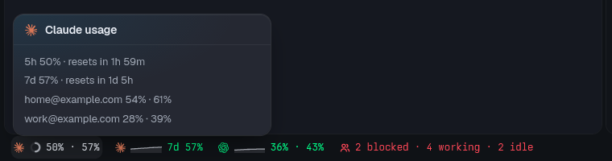
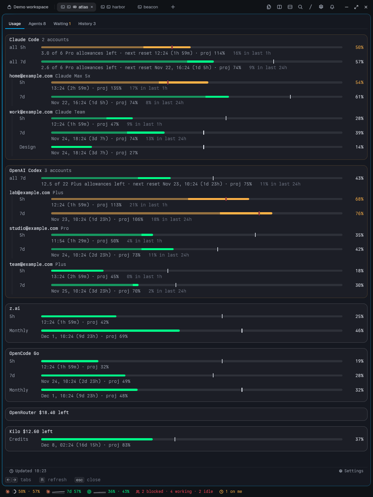
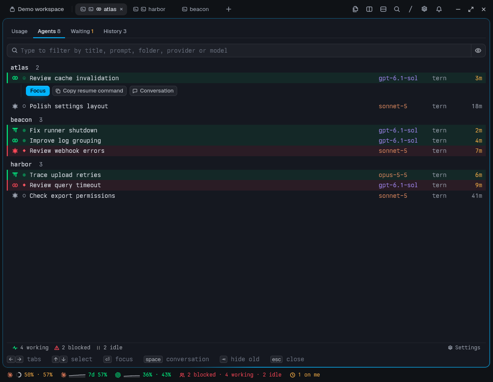
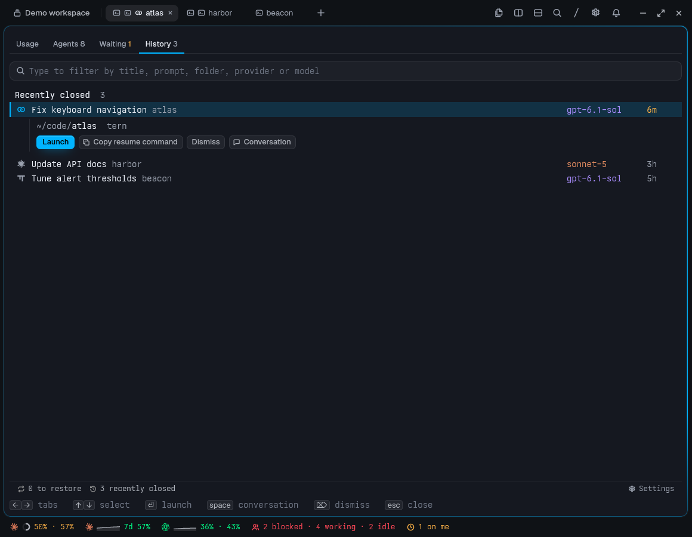
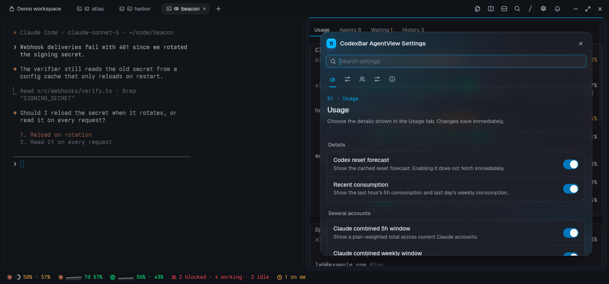
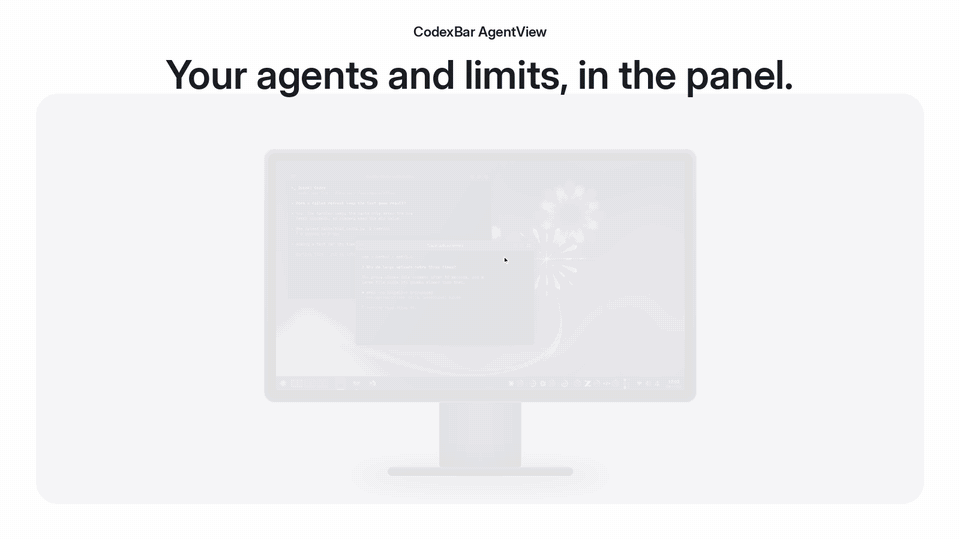
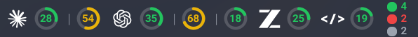
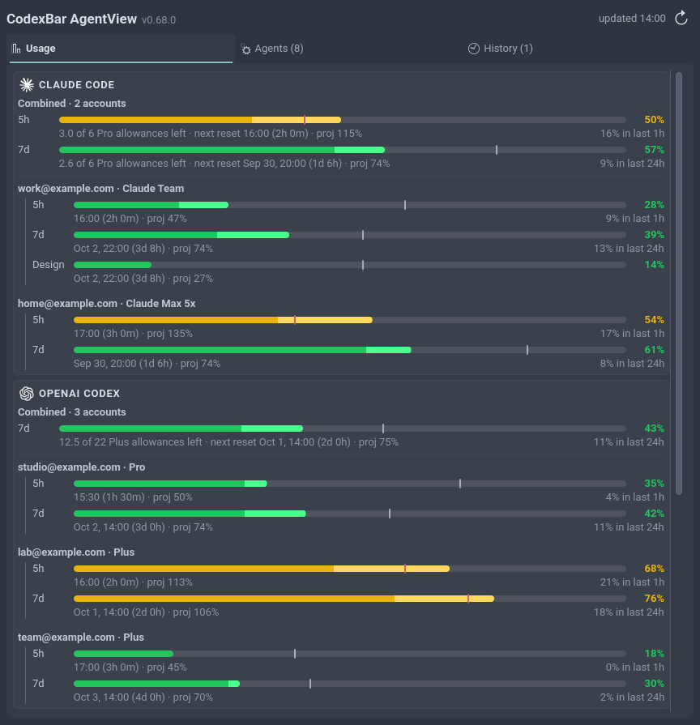
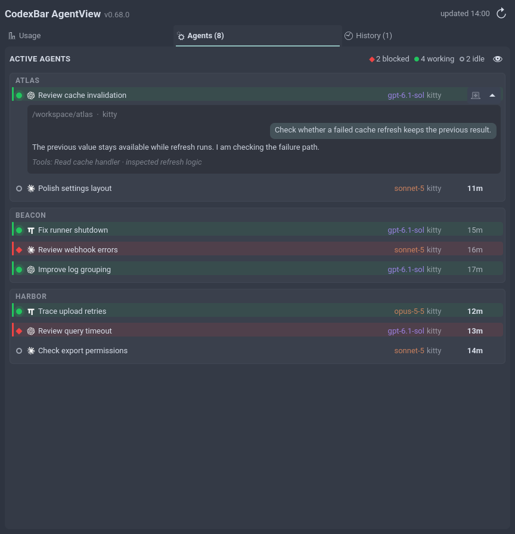

# CodexBar AgentView

A [Tern](https://stencil.so/tern) extension for working with coding agents. It
lists every Claude Code, Codex, OpenCode, pi and omp session you have running,
lets you set a session aside with a sentence about what it waits for, and puts
your AI provider usage in Tern's widget bar. It runs on Linux, macOS and
Windows.

A KDE Plasma 6 widget shows the same usage and agents in your panel. It's
optional: use it beside Tern, or on its own if you work in other terminals.

What you get:

- **Set sessions aside without losing why.** Write one sentence about why you
  stopped and say what the session waits for: a pull request, a release, a
  time, a check, a person, or "when I have time". Code watches the wait and
  sends the session its follow-up prompt when it fires. Ask the agent in plain
  words and it sets these up for you, repeating ones included.
  [See how](docs/waiting.md).
- **Who needs you, at a glance.** Tern's widget bar counts working, blocked
  and idle agents and the set-aside sessions back on you.
- **Find any session by typing.** Every Claude Code, Codex, OpenCode, pi
  and omp session in Tern, another terminal or T3 Code, filtered as you type,
  with a peek at its last messages.
- **Jump straight to it.** In Tern, `Enter` shows its pane. In Plasma, one
  click switches to the right desktop and raises the session's terminal.
- **Never leave the keyboard.** `Ctrl+Alt+A` in Tern or `Super+A` in Plasma
  opens the agent list. Type to filter, `↑`/`↓` to select, `Space` to peek,
  `Enter` to jump.
- **Get it all back.** After a reboot or crash, **Restore all** reopens your
  Tern sessions as tabs and your kitty sessions in their own windows. Closed
  one by mistake? Bring it back from History with one click.
- **No surprise limits.** Every account's usage in one place, with pace
  ticks and projections that warn you before a limit hits, not after.

It started as a Linux port of the macOS
[CodexBar](https://github.com/steipete/CodexBar) menu-bar app and uses its
`codexbar` CLI for usage data. It is an independent project, not an official
CodexBar module.

[Tern extension](#tern-extension) · [Set sessions aside](#set-sessions-aside) ·
[Install](#install) · [Shortcuts](#keyboard-shortcuts) ·
[Features](#features) · [Plasma widget](#kde-plasma-widget) ·
[Providers](#supported-providers) · [Agents](#supported-agent-sessions) ·
[Credentials](#provider-credentials) · [Update](#update)

## Tern extension


<details>
<summary>Screenshots</summary>



| Usage | Agents | History | Settings |
| :---: | :---: | :---: | :---: |
| [](docs/tern/usage.png) | [](docs/tern/agents.png) | [](docs/tern/history.png) | [](docs/tern/settings.png) |

</details>

The films and screenshots use made-up accounts and sessions.

## Set sessions aside

For the sessions you leave and come back to later. Set one aside with one
sentence about why you stopped and what it waits for, and optionally a prompt
to run when the wait is over. Code watches the wait without spending tokens.
When it fires, the session gets its prompt (Tern reopens it if you closed it),
and a card over the pane tells you what happened while you were away.

![Set sessions aside, one use case at a time, each explained beside the screen. It opens on the problem: sessions left open because they wait on something, tabs piling up, and each switch back costing context. Then, asked in plain words, the agent babysits a pull request, sets a check on a migration (the strip's closable badge is ringed, and the session is closed with Ctrl+Shift+W), and repeats a fleet check daily for a week; a task is put off with /wait later. Then the Waiting tab, Snooze session, a review landing on the PR that the agent fixes while parked until the PR is ready and then merged, and the migration finishing, which reopens the closed session so the agent can report. Last, the strip above the composer and the session card, each ringed and explained](docs/waiting.gif)

What you can now leave alone:

- A PR you opened: a review bot comments, the agent fixes what's real, round
  after round, and the wait follows it to ready and merged. `/wait gh babysit`
- A merge, then the release notes. `/wait gh pr 42 merged -- write the release notes`
- Someone else's fix: upgrade once their release ships.
  `/wait gh release vercel/next.js bump once their fix ships -- upgrade and run the tests`
- "Retry in two days." `/wait 2d upstream fix should be out by then -- retry the migration`
- A deploy or a job elsewhere, until a command passes.
  `/wait check every 10m ! curl -fsS https://staging.example.com/health -- run the smoke tests`
- A check on a schedule. `/wait every 1d for 1w -- run the e2e suite and list the flaky tests`
- A person's answer, a big task for a free afternoon, or a session you want out
  of sight for three days. `/wait for Anna's answer`, `/wait later L rewrite the sync engine`,
  `/wait snooze 3d`

**The agent can do all of it.** The whole toolkit is also its `waitingfor`
tool, so you can say it in your own words: "babysit the PR you just opened",
"tell me when CI on main is green, or on Friday either way", "check once a
week whether the restore test still passes". It picks the wait, the interval,
the deadline and the prompt. It never closes a session and never overwrites
your sentence.

**It works in plain omp, and best in Tern.** `/wait`, `Ctrl+Alt+B`, the row
above the composer and the agent's tool work in omp in any terminal, as long
as Tern runs in the background to check the waits. In Tern the session can
also be parked, the card floats over the pane, and shell panes and other
agents can be set aside too.

**Keys.** `Ctrl+Alt+B` sets the focused session aside, `Ctrl+Alt+W` opens the
Waiting tab, where every set-aside session is grouped by who has the next
step, and `Ctrl+Alt+I` opens a session's card. [tern-awui](https://github.com/materemias/tern-awui)
shows the same list on your phone.

[Set sessions aside](docs/waiting.md) explains every use case, what each wait
watches, what happens when one fires, Seen, Stop and Snooze, when a session is
safe to close, and every keyboard shortcut.

## Requirements

The Tern extension and the omp extension run on Linux, macOS and Windows. The
Plasma widget needs Linux and KDE Plasma 6. The `codexbar` CLI has no Windows
build, so there usage comes from Meridian only, or you turn it off.

| Requirement | Tern | Plasma | Enables |
| --- | :---: | :---: | --- |
| [Tern](https://stencil.so/tern) 0.9.18 or later | Required | | The extension |
| Python 3.10+ | Required | Required | The shared helpers |
| [omp](https://github.com/can1357/oh-my-pi) | Optional | Optional | `/wait`, the agent's `waitingfor` tool, the row above the composer and prompt delivery for set-aside sessions |
| [`gh`](https://cli.github.com), logged in | Optional | Optional | Pull request and release waits |
| [`codexbar`](https://github.com/steipete/CodexBar) CLI | Optional | Optional | Usage, which you can turn off. Agents, History and Waiting work without it; with Meridian, so do Claude and Codex seats |
| [Meridian](https://github.com/rynfar/meridian) | Optional | Optional | Claude accounts and ChatGPT seats read from its usage poll |
| kitty | Optional | Optional | Launch and Restore all for kitty sessions; with Tern, Teleport to Tern |
| kitty remote control | Optional | Optional | Exact focus of kitty windows |
| KDE Plasma 6 with KWin | | Required | The widget |
| CMake 3.21+, C++17 compiler, Qt 6 QML headers | | Required | Building the widget (Arch: `base-devel cmake qt6-declarative`) |
| `qdbus6` | | Optional | Click to focus and desktop switching |
| `notify-send` | | Optional | Usage and waiting-for-input alerts |

## Install

### Tern extension

Clone the repository and link the extension:

```sh
git clone https://github.com/materemias/codexbar-agentview
cd codexbar-agentview
tern plugin link tern
```

Keep the checkout in place while the extension is linked; it runs its helpers
from there.

Then place its widgets: palette › **Edit widgets…**, or for example
`tern ctl widgets set codexbar-agentview/claude@ring codexbar-agentview/codex@ring codexbar-agentview/agents codexbar-agentview/on-me spacer status`
from a Tern pane, which replaces the whole bar.

On macOS:

- Install Tern, Python 3.10+ and the CodexBar CLI, then link as above.
- The extension finds Python and `codexbar` in both Homebrew prefixes, even
  when Tern starts from Finder with a short `PATH`.
- Claude usage needs the unlocked desktop session, because the CLI reads
  Claude's token from the login Keychain.
- Restores open on the current desktop.

On Windows:

- Install Tern and Python 3.10+ from python.org (the `py` launcher), then
  link as above. Tern and the omp extension start the helpers with `py -3`,
  else `python`; the Microsoft Store `python3` alias is never used.
- State lives in `%LOCALAPPDATA%\codexbar-agentview`.
- Agents lists only sessions running in Tern panes. omp sessions are matched
  exactly once the omp extension reports them, Claude Code through its session
  file; a new Codex session shows but isn't matched exactly.
- Resume and Launch open the session's folder in `powershell -NoExit`.
- A typed check (`/wait check ! …`) runs in Windows PowerShell and passes when
  the line exits 0, so end it with `if (…) { exit 0 } else { exit 1 }`. A
  check the agent writes as an argv list runs `.exe` programs only.
- Kitty, Teleport and Restore into kitty don't exist there.

### omp extension (set-aside sessions)

The extension gives omp the `/wait` command and the `waitingfor` agent tool,
draws the row above the composer and delivers wait prompts. Run the Tern
palette command `CodexBar AgentView: Install omp extension`, or from the
checkout:

```sh
python3 contents/scripts/install_integration.py --omp-extension
```

The Plasma package includes the omp extension. The installer links
`~/.omp/agent/extensions/codexbar-waitingfor.ts` (under
`$PI_CODING_AGENT_DIR` or `$OMP_AGENT_DIR` when set) to the installed package
or checkout it runs from; on Windows, where a link needs Developer Mode, it
writes a one-line loader file there instead. Keep that source in place. omp
loads extensions at start, so run `/restart` in sessions that were already
open. `--omp-extension --uninstall` removes the link or loader. What it does:
[Session lifecycle](docs/session-lifecycle.md).

### Plasma widget (optional)

Skip this unless you want usage and agents in a KDE panel too.

1. Build and install. The package has a small native QML plugin, so build it
   on the machine that runs it:

   ```sh
   git clone https://github.com/materemias/codexbar-agentview
   cd codexbar-agentview
   cmake -S . -B build
   cmake --build build
   kpackagetool6 -t Plasma/Applet -i build/package
   ```

2. Right-click the panel → **Enter Edit Mode** → **Add Widgets…**, search for
   **CodexBar AgentView** and drag it onto the panel.
3. In the widget's settings, open **Agents** and click **Install**, then run
   `systemctl --user restart plasma-plasmashell.service` once. Agents and
   History stay empty until you do.
4. [Add credentials](#provider-credentials) for providers beyond Claude and
   Codex.

The `codexbar` path defaults to `/usr/bin/codexbar`, where Arch's
`codexbar-cli` package puts it. Change it in Settings → Backend.

Updating file associations preserves existing settings, including symlinked
configuration. A failed write leaves the original configuration intact.

## Keyboard shortcuts

| Key | Action | Where |
| --- | --- | --- |
| `Super+A` | Open the popup on Agents | Plasma |
| `Ctrl+Alt+A` / `Ctrl+Alt+U` / `Ctrl+Alt+W` / `Ctrl+Alt+H` | Toggle the dashboard on Agents / Usage / Waiting / History | Tern |
| `Ctrl+Alt+B` | Set the focused session aside (in omp outside Tern too) | Tern, omp |
| `Ctrl+Alt+I` | Show or hide the focused session's card (in omp outside Tern: its details above the composer) | Tern, omp |
| `←` / `→` | Switch tabs | Both |
| `↑` / `↓` | Select a row on Agents, Waiting or History | Both |
| `Space` | Peek at the selected session; while filtering, types a space | Both |
| `Enter` | Agents: jump to the session. History: launch it. Waiting: open or resume it | Both |
| `Shift+Enter` | Agents and Waiting: open the selected session's card | Tern |
| `Tab` | Hide or show sessions idle for over a day | Both |
| `Delete` | Dismiss the selected History row; Waiting: Seen, you've read what's on you | Tern |
| `F2` | Waiting: edit what the selected session waits for, in your words | Tern |
| `+` | Waiting: push the selected wait that's on you by a day | Tern |
| `F4` | Waiting: snooze the selected session; it comes back by itself | Tern |
| `R` | Refresh (Usage tab) | Both |
| Typing | Filter Agents, Waiting and History | Both |
| `Esc` | Clear the filter, keeping the selected session, then close | Both |

KDE binds `Ctrl+Alt+A` to Activate Window Demanding Attention. Clear it in
System Settings → Shortcuts → KWin, or Tern never sees the key.

[Set sessions aside](docs/waiting.md#keyboard-shortcuts) lists the waiting
keys by place: anywhere in Tern, in omp, and on the Waiting tab.

## Features

### Waiting (set-aside sessions)

`Ctrl+Alt+B` or `/wait` sets a session aside with your sentence and what it
waits for. The Waiting tab (`Ctrl+Alt+W`) groups the set-aside sessions by who
has the next step, and the session card (`Ctrl+Alt+I`) shows one session's
waits, what happened since and what's next. See [Set sessions aside](#set-sessions-aside)
above and [the full guide](docs/waiting.md). [Session lifecycle](docs/session-lifecycle.md)
is the technical reference: every option, how each wait is checked, and how
it works.

### Agents

- **Live sessions,** grouped by project folder, newest first, with model,
  terminal and time in the current state. Working is a pulsing green dot,
  blocked on your input a red diamond, idle a grey ring.
- **Filter by typing.** Title, prompt, folder, provider, model and recent
  messages. Separate words with spaces: each must match somewhere, in any
  order, and each match is highlighted. Word starts work too: `fmh` finds
  "Fix MCP history" and `autor` finds "Auto-Research", but only across
  neighbouring words.
- **Peek** at the last eight turns, laid out like a chat, and the agent's
  latest recap (omp and Claude Code write them).
- **Focus.** Plasma switches desktop and raises the terminal. Tern shows the
  pane, a kitty window or a T3 Code thread.
- **Teleport to Tern.** Moves an idle kitty session into a new Tern tab.
- **Hide old sessions** idle for over a day with `Tab` or the eye switch
  (in Tern, the eye at the end of the filter field).
  Working and blocked sessions always stay.
- **Desktop badges** and a ring on the session in the window you last focused.

### History

- **Interrupted by restart.** Every session that was running before the last
  reboot, in desktop order, until it runs again. **Restore all** brings them
  back one by one: kitty sessions on their saved desktop, Tern sessions as
  tabs.
- **Recently closed.** The last 100 sessions that exited (set in Settings; up
  to 1000 are kept), each with
  **Launch** and a copyable resume command. omp and Claude Code sessions that
  closed while nothing watched, or before you installed this, come from their
  prompt history (`~/.omp/agent/history.db`, `~/.claude/history.jsonl`) while
  their transcript and folder exist and no process runs them; they launch in
  Tern when it is installed, else kitty. Claude Code deletes transcripts after
  30 days by default (`cleanupPeriodDays`), so older sessions don't come back.
  A dismissed session stays gone until you use it again.

Launch and Teleport share a startup guard for each session. A second request
while it starts asks you to retry; the startup reservation lasts up to
60 seconds. A session that is already running cannot be resumed again.

### Usage

- **Meters per provider.** Bars with percent used and reset countdown. Balance
  providers (OpenRouter, Kilo, TypeSafe) show what is left instead. A Claude
  window nobody has used since its reset reads `not started · resets 5h after
  first use`: Anthropic starts the next window on the first message.
- **Pace.** Each bar has a tick where even use would sit right now, and the
  reset line adds `proj N%`, the usage at reset if the current rate holds.
  Bars stay green while you are behind the tick, whatever the percentage.
  Four hours into a 5h window the tick is at 80%, so 79% is green, 81% yellow,
  87% orange and 94% red.
- **Several Codex accounts.** One card, one row per account, and a combined
  bar that pools them in Plus allowances (Pro counts as 20).
- **Several Claude accounts.** One card with a row per account, email and
  plan (Claude Team, Claude Max 5x), one for each Meridian profile, and
  combined 5h and 7d bars that pool them in Pro allowances (Max 5x and Team
  seats on the 5x tier count as 5, Max 20x as 20).
- **Recent usage.** 7d bars highlight what the last 24 hours used, 5h bars the
  last hour, e.g. `13% in last 24h`.
- **Saved resets.** Claude and Codex show unused reset credits and when the
  soonest expires.
- **omp rotation.** When omp's `sub-rotate` extension rotates Claude
  (Meridian profiles) or Codex accounts, the card header shows its operating
  mode and rule (`omp · auto FILL`), and each account is marked 🟢 open or
  🔒 closed. Read from `~/.omp/agent/sub-rotate/{meridian,codex}-state.json`;
  without a state file nothing is shown.
- **Codex reset forecast** from [codex-reset.com](https://codex-reset.com):
  announced, likely with a chance, or unknown with how long it has been.
- **Last known.** When a refresh fails, the last reading stays, muted and
  marked with its time. A single failed Meridian poll on a reading under
  10 minutes old shows no error, since Meridian retries on its own.
- **Shared refreshes.** Plasma and Tern coordinate usage fetches so overlapping
  polls reuse the same reading within the configured refresh interval.
  Recent successful shared readings still drive usage warnings in Plasma.
  Refresh now and CLI changes fetch immediately.
- **Warnings.** A desktop alert at 80% and 95%, or earlier when the pace says
  the window runs out before it resets, once a quarter of the window has
  passed. Alerts from one refresh arrive as one notification, and so do
  several agents waiting for input at once. Plasma only.
- **Optional.** Usage tracking is on by default. Turn it off when you don't
  have the `codexbar` CLI or track usage elsewhere: Plasma's **Track usage**
  switch (Settings → Backend), or Tern's **Usage tracking** (Settings →
  General). Off, nothing fetches usage and
  no meters, cards or alerts show; Agents, History and Waiting work as before.
  When it's on but the CLI is missing, the usage area says what to install
  and offers to turn tracking off.

### Widget bar (Tern)

Place any of these through palette › **Edit widgets…**; each hides itself
while it has nothing to show, and a click opens the matching dashboard tab.

| Widget | Shows |
| --- | --- |
| Claude usage, Codex usage | 5h and 7d percent, plan-weighted across all your accounts as the combined bars are. The ring and bar show the combined 5h window, the graph its last five hours; hover for each window's reset and every account's 5h and 7d percent |
| Claude weekly usage, Codex weekly usage | The combined 7d window alone; the graph spans the week |
| z.ai, OpenCode Go, OpenRouter, Kilo, TypeSafe usage | Each window's percent, or the balance; the ring, bar and graph show the shortest window |
| Coding agents | Blocked, working and idle agents, in Tern and outside it |
| Back on me | Set-aside sessions whose next step is yours |
| Sessions to restore | Sessions a reboot closed |

Usage widgets carry the provider's logo, take the pace colours of the Usage
tab and offer ring, graph, bar and text styles. Graphs draw from the readings
the helpers keep: a week of them, the last day as polled and older ones one per
30 minutes. A graph needs readings from every pooled account and stays empty
while one has none; until a week has been recorded it spans what there is. The
focused pane's set-aside status stays in the **Plugin segments** widget.

### Tern specifics

The dashboard opens to the right of your rightmost pane and closes when you
focus anything else, putting the layout back as it was. Palette commands
`CodexBar AgentView: Agents`, `Usage`, `Waiting`, `History`, `Settings`,
`Set aside…` and `Install omp extension` cover what the
keys do not. Settings, also at the right of the dashboard's status bar,
opens over the dashboard as a dialog in the style of Tern's and omp's own
settings, with search; **Include non-Tern agents** (off by default)
adds kitty, VS Code and other hosts. Desktop notifications and the panel are
Plasma-only.

## KDE Plasma widget

The optional panel widget: usage rings and agent dots in the panel, and a
popup with the Agents, History and Usage tabs. With **Tern integration** on
(Settings → Agents), its Agents list also marks set-aside sessions.



<details>
<summary>Screenshots</summary>

[](docs/panel.png)

| Usage | Agents | History |
| :---: | :---: | :---: |
| [](docs/plasma-usage.png) | [](docs/plasma-agents.png) | [](docs/plasma-history.png) |

</details>

### Panel

Usage rings per provider and window, coloured by pace, which you can set to
appear only once a window is projected to run out. Coloured dots count
working, blocked and idle agents. The popup opens on Agents when one is
blocked and on History when sessions wait to be restored.

With several Claude or Codex accounts, the tray settings list each account
with its own windows. A meter picked before the accounts were known (saved as
`claude:primary`) shows every account's window until you change one account,
which turns it into one meter per account
(`claude:<email>:primary`).

## Supported providers

These are the providers I use and have tested. Others the CodexBar CLI
supports on Linux are usually easy to add.

| Provider | Auth | Shows |
| --- | --- | --- |
| Claude | OAuth: Meridian profiles, else `~/.claude` | 5h and 7d per account, plus Claude Design and Daily Routines |
| Codex | OAuth (`~/.codex/auth.json`), plus Meridian's ChatGPT seats | 5h and weekly per account, plus Reserve 7d |
| z.ai | `ZAI_API_KEY` | 5h and monthly |
| OpenCode Go | `apiKey` in config | 5h, 7d and monthly |
| OpenRouter | `apiKey` in config | Balance; a bar when the key has a limit |
| Kilo | `apiKey` in config | Credit balance |
| TypeSafe | `cookieHeader` in config; off by default | Credit balance |

## Supported agent sessions

Claude Code, Codex CLI, OpenCode, pi and omp, found by scanning processes and
reading their session files. No daemon or agent hooks are needed.

Sessions show up in kitty, Tern, Konsole, WezTerm, Alacritty, Ghostty, foot,
GNOME Terminal, Tilix, Yakuake, xterm, tmux, VS Code and T3 Code. A process
whose session cannot be identified is listed as untracked. Some sessions stay
off the list on purpose: Claude Code's agent view tasks, which run under
`claude daemon`, and omp or pi driven by another program (`--mode rpc`/`json`).

Focusing a T3 Code session opens its thread. This needs T3 Code 0.1 or later;
older versions only raise the window.

## Provider credentials

Plasma does not see keys exported in your shell profile, so put them in
`~/.codexbar/config.json`, which the `codexbar` CLI reads:

```json
{
  "version": 1,
  "providers": [
    {"id": "codex", "enabled": true, "codexProfileHomePaths": ["~/.codex-pro"]},
    {"id": "zai",   "enabled": true, "apiKey": "<from https://z.ai/manage-apikey/apikey>"},
    {"id": "opencodego", "enabled": true, "apiKey": "<your opencode-go key, see ~/.local/share/opencode/auth.json>"},
    {"id": "kilo",  "enabled": true, "apiKey": "<from app.kilo.ai>"},
    {"id": "openrouter", "enabled": true, "apiKey": "<management key from https://openrouter.ai/settings/keys>"},
    {"id": "typesafe", "enabled": true, "cookieSource": "manual", "cookieHeader": "<Cookie: header copied from https://console.typesafe.ai/settings/billing>"}
  ]
}
```

Then `chmod 600 ~/.codexbar/config.json`.

- **More Codex accounts.** Log in to a separate home with
  `CODEX_HOME=~/.codex-pro codex login` and list it in `codexProfileHomePaths`.
  A running Meridian's ChatGPT seats are added too (see [Meridian](#meridian)).
- **More Claude accounts** come from Meridian profiles, in this order:
  1. A running Meridian's local API (`127.0.0.1:$MERIDIAN_PORT`, default
     3456). It already polls Anthropic's usage endpoint, which rate-limits
     per access token, so the widget reads usage from Meridian. Meridian 1.87
     and later also list saved resets; with an older one the widget asks
     Anthropic for them at most once an hour per account.
  2. If Meridian is not answering, the CLI runs once per login directory in
     `~/.config/meridian/profiles.json`, with `CLAUDE_CONFIG_DIR` set to it.
  3. Without profiles, the single login in `~/.claude`, or
     `CLAUDE_CONFIG_DIR` when set.
- **OpenRouter** needs a management key; a plain inference key gets HTTP 403
  on the credits endpoint.
- **TypeSafe** (CLI 0.64.0+) has no API. On Linux, copy the `Cookie:` header
  of a signed-in billing page request from your browser's dev tools. Paste a
  fresh one when the row says the session expired.

## Meridian

[Meridian](https://github.com/rynfar/meridian) is optional. Every Claude fact
the widget shows (accounts, usage, saved resets, email and plan) comes from a
running Meridian first, then from the login directory, and only then from
Anthropic or the `codexbar` CLI. Meridian already polls Anthropic's usage
endpoint, which rate-limits per access token, so reading its copy keeps the
widget from competing with it.

Set `MERIDIAN_PORT` (default 3456) and, when Meridian requires one,
`MERIDIAN_API_KEY` in the environment Plasma or Tern starts with.

| Meridian | `codexbar` CLI | Claude | Codex | Other providers |
| --- | --- | --- | --- | --- |
| Running | Installed | From Meridian | CLI accounts plus Meridian's ChatGPT seats; the CLI's reading wins for an account both know, since it carries Reserve and saved resets | From the CLI |
| Running | Missing | From Meridian | Meridian's ChatGPT seats | "CLI not found" |
| Stopped | Installed | The CLI once per login directory | From the CLI | From the CLI |
| Stopped | Missing | Last-known usage, with one error naming both | Last-known usage | Last-known usage |

### Compatibility

| Meridian | What the widget reads from it |
| --- | --- |
| 1.87.0+ | Everything below, plus saved resets (`bankedResets`): the widget makes no Anthropic call for Claude |
| 1.83.0 – 1.86.x | Claude profiles with usage, email and plan, and ChatGPT seats (added in 1.83.0) as Codex accounts. Saved resets come from Anthropic, at most once an hour per account |
| Older | Untested. Claude profiles may work; a field Meridian does not send comes from the login directory |

Tested live with 1.85.0; ChatGPT seats are tested only against Meridian's
documented response shape. A Meridian without profiles serves the local
`~/.claude` login, which the widget shows as one account.

## Settings

Each interface keeps its own settings. Right-click the widget → **Configure
CodexBar AgentView**, or run `CodexBar AgentView: Settings` in Tern. Usage
warnings are on by default and waiting-for-input alerts off.

## Update

Tern extension. Close any open dashboard first so it can restore your layout:

```sh
git pull
tern plugin reload
```

Plasma widget. Stop Plasma before replacing the native plugin;
`systemctl --user stop` waits for plasmashell to exit, `kquitapp6` does not:

```sh
git pull
cmake -S . -B build && cmake --build build
systemctl --user stop plasma-plasmashell.service
kpackagetool6 -t Plasma/Applet -u build/package
systemctl --user start plasma-plasmashell.service
```

If an update deleted files, replace the `-u` line with
`kpackagetool6 -t Plasma/Applet -r io.github.materemias.codexbaragentview`
followed by `kpackagetool6 -t Plasma/Applet -i build/package`.

<details>
<summary>Upgrading from codexbar-kde</summary>

The widget ID, Tern plugin ID and URL handler changed with the rename.
Sessions, history and the usage cache move to
`~/.local/state/codexbar-agentview/` the first time a helper runs;
`~/.codexbar/config.json` stays.

Point the existing panel widget at the new package so it keeps its place and
settings:

```sh
git pull
cmake -S . -B build && cmake --build build
systemctl --user stop plasma-plasmashell.service
kpackagetool6 -t Plasma/Applet -i build/package
sed -i 's/^plugin=org\.codexbar\.plasmoid$/plugin=io.github.materemias.codexbaragentview/' \
  ~/.config/plasma-org.kde.plasma.desktop-appletsrc
kpackagetool6 -t Plasma/Applet -r org.codexbar.plasmoid
systemctl --user start plasma-plasmashell.service
```

Then click widget settings → **Agents** → **Install** again. Relink the Tern
extension; it copies its old settings on first start:

```sh
tern plugin unlink codexbar
tern plugin link tern
```

</details>

## Uninstall

```sh
tern plugin unlink codexbar-agentview
python3 contents/scripts/install_integration.py --omp-extension --uninstall
```

For the Plasma widget, click Settings → Agents → **Remove** if you installed
the integration, then:

```sh
kpackagetool6 -t Plasma/Applet -r io.github.materemias.codexbaragentview
```

## Development

Build and test with `cmake -S . -B build -DCODEXBAR_BUILD_TESTS=ON`,
`cmake --build build` and `ctest --test-dir build`, and run the Python tests
with `python tests/run.py` (parallel; `-j N` sets the workers, names narrow
it). Re-render the films with
`uv run film/take_kde.py && uv run film/compose.py kde`, or `take_tern.py` and
`compose.py tern`, or `take_waiting.py` and `compose.py waiting`; the Tern takes
open a window on a scratch daemon for about a minute.

## License

MIT. See [`LICENSE`](LICENSE). Provider logos under `contents/icons/` are
trademarks of their owners, used only to identify them. See
[`NOTICE`](NOTICE).
