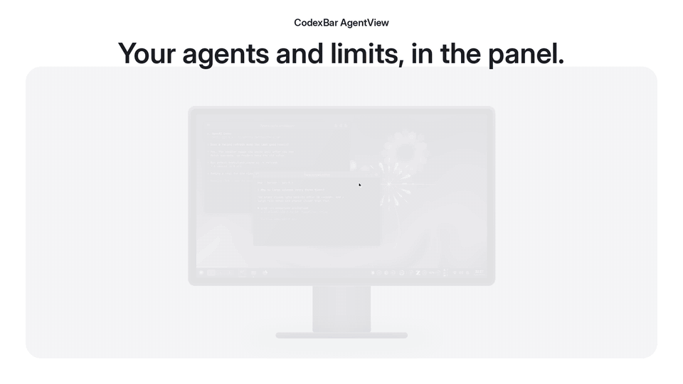
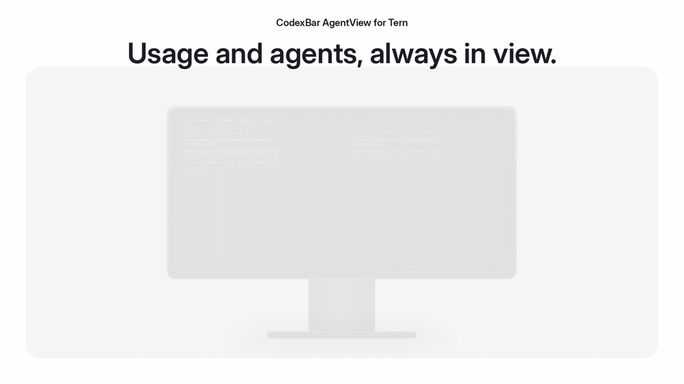

# CodexBar AgentView

AI provider usage and your running coding agents, in one place. It comes in two
interfaces:

- A **KDE Plasma 6 widget** puts usage rings and agent counts in your panel,
  with a popup for Usage, Agents and History and a global shortcut.
- A **Tern extension** runs on Linux and macOS. It puts usage and agent counts
  in Tern's status line and opens the same three tabs as a temporary sidebar.

What you get:

- **No surprise limits.** Every account's usage in one place, with pace
  ticks and projections that warn you before a limit hits, not after.
- **Who needs you, at a glance.** Panel dots or Tern's status line count
  working, blocked and idle agents, so a session waiting for input finds you.
- **Find any session by typing.** Every Claude Code, Codex, OpenCode, pi
  and omp session in a terminal or T3 Code, filtered as you type, with a peek
  at its last messages.
- **Jump straight to it.** In Plasma, one click switches to the right desktop
  and raises the session's terminal. In Tern, `Enter` shows its pane.
- **Never leave the keyboard.** `Super+A` in Plasma or `Ctrl+Alt+A` in Tern
  opens the agent list. Type to filter, `↑`/`↓` to select, `Space` to peek,
  `Enter` to jump.
- **Get it all back.** After a reboot or crash, **Restore all** reopens your
  kitty sessions in their own windows and your Tern sessions as tabs. Closed
  one by mistake? Bring it back from History with one click.

Use either interface, or both. 

It started as a Linux port of the macOS
[CodexBar](https://github.com/steipete/CodexBar) menu-bar app and uses its
`codexbar` CLI for usage data. It is an independent project, not an official
CodexBar module.

[Plasma widget](#kde-plasma-widget) · [Tern extension](#tern-extension) ·
[Install](#install) · [Shortcuts](#keyboard-shortcuts) ·
[Features](#features) · [Providers](#supported-providers) ·
[Agents](#supported-agent-sessions) · [Credentials](#provider-credentials) ·
[Update](#update)

## KDE Plasma widget



<details>
<summary>Screenshots</summary>

[](docs/panel.png)

| Usage | Agents | History |
| :---: | :---: | :---: |
| [](docs/plasma-usage.png) | [](docs/plasma-agents.png) | [](docs/plasma-history.png) |

</details>

## Tern extension



<details>
<summary>Screenshots</summary>


| Usage | Agents | History | Settings |
| :---: | :---: | :---: | :---: |
| [](docs/tern/usage.png) | [](docs/tern/agents.png) | [](docs/tern/history.png) | [](docs/tern/settings-general.png) |

</details>

The films and screenshots use made-up accounts and sessions.

## Requirements

The Plasma widget needs Linux and KDE Plasma 6. The Tern extension runs on
Linux and macOS. Windows is not supported, since there is no `codexbar` CLI
for it.

| Requirement | Plasma | Tern | Enables |
| --- | :---: | :---: | --- |
| KDE Plasma 6 with KWin | Required | | The widget |
| [Tern](https://stencil.so/tern) | | Required | The extension |
| Python 3.10+ | Required | Required | The shared helpers |
| [`codexbar`](https://github.com/steipete/CodexBar) CLI | Required | Required | Usage. Agents and History work without it |
| CMake 3.21+, C++17 compiler, Qt 6 QML headers | Required | | Building the widget (Arch: `base-devel cmake qt6-declarative`) |
| `qdbus6` | Optional | | Click to focus and desktop switching |
| kitty or Tern | Optional | Optional | Launch and Restore all; with both, Teleport to Tern |
| kitty remote control | Optional | Optional | Exact focus of kitty windows |
| `notify-send` | Optional | | Usage and waiting-for-input alerts |

## Install

### Plasma widget

1. Build and install. The package has a small native QML plugin, so build it
   on the machine that runs it:

   ```sh
   git clone https://github.com/materemias/codexbar-agentview
   cd codexbar-agentview
   cmake -S . -B build
   cmake --build build
   kpackagetool6 -t Plasma/Applet -i build/package
   ```

2. Right-click the panel → **Enter Edit Mode** → **Add Widgets…**, search for
   **CodexBar AgentView** and drag it onto the panel.
3. In the widget's settings, open **Agents** and click **Install**, then run
   `systemctl --user restart plasma-plasmashell.service` once. Agents and
   History stay empty until you do.
4. [Add credentials](#provider-credentials) for providers beyond Claude and
   Codex.

The `codexbar` path defaults to `/usr/bin/codexbar`, where Arch's
`codexbar-cli` package puts it. Change it in Settings → Backend.

### Tern extension

From the repository root:

```sh
tern plugin link tern
```

Keep the checkout in place while the extension is linked; it runs its helpers
from there.

On macOS:

- Install Tern, Python 3.10+ and the CodexBar CLI, then link as above.
- The extension finds Python and `codexbar` in both Homebrew prefixes, even
  when Tern starts from Finder with a short `PATH`.
- Claude usage needs the unlocked desktop session, because the CLI reads
  Claude's token from the login Keychain.
- Restores open on the current desktop.

## Keyboard shortcuts

| Key | Action | Where |
| --- | --- | --- |
| `Super+A` | Open the popup on Agents | Plasma |
| `Ctrl+Alt+A` / `Ctrl+Alt+U` | Toggle the dashboard on Agents / Usage | Tern |
| `←` / `→` | Switch tabs | Both |
| `↑` / `↓` | Select a row on Agents or History | Both |
| `Space` | Peek at the selected session | Both |
| `Enter` | Agents: jump to the session. History: launch it | Both |
| `Tab` | Hide or show sessions idle for over a day | Both |
| `Delete` | Dismiss the selected History row | Tern |
| `R` | Refresh (Usage tab) | Both |
| Typing | Filter Agents and History | Both |
| `Esc` | Clear the filter, then close | Both |

KDE binds `Ctrl+Alt+A` to Activate Window Demanding Attention. Clear it in
System Settings → Shortcuts → KWin, or Tern never sees the key.

## Features

### Usage

- **Meters per provider.** Bars with percent used and reset countdown. Balance
  providers (OpenRouter, Kilo, TypeSafe) show what is left instead.
- **Pace.** Each bar has a tick where even use would sit right now, and the
  reset line adds `proj N%`, the usage at reset if the current rate holds.
  Bars stay green while you are behind the tick, whatever the percentage.
  Four hours into a 5h window the tick is at 80%, so 79% is green, 81% yellow,
  87% orange and 94% red.
- **Several Codex accounts.** One card, one row per account, and a combined
  bar that pools them in Plus allowances (Pro counts as 20).
- **Recent usage.** 7d bars highlight what the last 24 hours used, 5h bars the
  last hour, e.g. `13% in last 24h`.
- **Saved resets.** Claude and Codex show unused reset credits and when the
  soonest expires.
- **Codex reset forecast** from [codex-reset.com](https://codex-reset.com):
  announced, likely with a chance, or unknown with how long it has been.
- **Last known.** When a refresh fails, the last reading stays, muted and
  marked with its time.
- **Warnings.** A desktop alert at 80% and 95%, or earlier when the pace says
  the window runs out before it resets. Plasma only.

### Agents

- **Live sessions,** grouped by project folder, newest first, with model,
  terminal and time in the current state. Working is a pulsing green dot,
  blocked on your input a red diamond, idle a grey ring.
- **Filter by typing.** Title, prompt, folder, provider, model and recent
  messages. Initials work too: `fmh` finds "Fix MCP history".
- **Peek** at the last eight turns, laid out like a chat, and the agent's
  latest recap (omp and Claude Code write them).
- **Focus.** Plasma switches desktop and raises the terminal. Tern shows the
  pane, a kitty window or a T3 Code thread.
- **Teleport to Tern.** Moves an idle kitty session into a new Tern tab.
- **Hide old sessions** idle for over a day with `Tab` or the eye switch.
  Working and blocked sessions always stay.
- **Desktop badges** and a ring on the session in the window you last focused.

### History

- **Interrupted by restart.** Every session that was running before the last
  reboot, in desktop order, until it runs again. **Restore all** brings them
  back one by one: kitty sessions on their saved desktop, Tern sessions as
  tabs.
- **Recently closed.** The last 100 sessions that exited since boot, each with
  **Launch** and a copyable resume command.

### Panel (Plasma)

Usage rings per provider and window, coloured by pace, which you can set to
appear only once a window is projected to run out. Coloured dots count
working, blocked and idle agents. The popup opens on Agents when one is
blocked and on History when sessions wait to be restored.

### Tern specifics

The dashboard opens to the right of your rightmost pane and closes when you
focus anything else, putting the layout back as it was. Palette commands
`CodexBar AgentView: Agents`, `Usage`, `History` and `Settings` cover what the
keys do not. Settings opens a native tab with search; **Include non-Tern
agents** (off by default) adds kitty, VS Code and other hosts. Desktop
notifications and the panel are Plasma-only.

## Supported providers

These are the providers I use and have tested. Others the CodexBar CLI
supports on Linux are usually easy to add.

| Provider | Auth | Shows |
| --- | --- | --- |
| Claude | OAuth (`~/.claude/.credentials.json`) | 5h and 7d, plus Claude Design and Daily Routines |
| Codex | OAuth (`~/.codex/auth.json`) | 5h and weekly per account, plus Reserve 7d |
| z.ai | `ZAI_API_KEY` | 5h and monthly |
| OpenCode Go | `apiKey` in config | 5h, 7d and monthly |
| OpenRouter | `apiKey` in config | Balance; a bar when the key has a limit |
| Kilo | `apiKey` in config | Credit balance |
| TypeSafe | `cookieHeader` in config; off by default | Credit balance |

## Supported agent sessions

Claude Code, Codex CLI, OpenCode, pi and omp, found by scanning processes and
reading their session files. No daemon or agent hooks are needed.

Sessions show up in kitty, Tern, Konsole, WezTerm, Alacritty, Ghostty, foot,
GNOME Terminal, Tilix, Yakuake, xterm, tmux, VS Code and T3 Code. A process
whose session cannot be identified is listed as untracked. Some sessions stay
off the list on purpose: Claude Code's agent view tasks, which run under
`claude daemon`, and omp or pi driven by another program (`--mode rpc`/`json`).

T3 Code threads can be focused, but T3 Code 0.0.44 opens the window without
the thread until
[pingdotgg/t3code#9745](https://github.com/pingdotgg/t3code/issues/9745) is
fixed.

## Provider credentials

Plasma does not see keys exported in your shell profile, so put them in
`~/.codexbar/config.json`, which the `codexbar` CLI reads:

```json
{
  "version": 1,
  "providers": [
    {"id": "codex", "enabled": true, "codexProfileHomePaths": ["~/.codex-pro"]},
    {"id": "zai",   "enabled": true, "apiKey": "<from https://z.ai/manage-apikey/apikey>"},
    {"id": "opencodego", "enabled": true, "apiKey": "<your opencode-go key, see ~/.local/share/opencode/auth.json>"},
    {"id": "kilo",  "enabled": true, "apiKey": "<from app.kilo.ai>"},
    {"id": "openrouter", "enabled": true, "apiKey": "<management key from https://openrouter.ai/settings/keys>"},
    {"id": "typesafe", "enabled": true, "cookieSource": "manual", "cookieHeader": "<Cookie: header copied from https://console.typesafe.ai/settings/billing>"}
  ]
}
```

Then `chmod 600 ~/.codexbar/config.json`.

- **More Codex accounts.** Log in to a separate home with
  `CODEX_HOME=~/.codex-pro codex login` and list it in `codexProfileHomePaths`.
- **OpenRouter** needs a management key; a plain inference key gets HTTP 403
  on the credits endpoint.
- **TypeSafe** (CLI 0.64.0+) has no API. On Linux, copy the `Cookie:` header
  of a signed-in billing page request from your browser's dev tools. Paste a
  fresh one when the row says the session expired.

## Settings

Each interface keeps its own settings. Right-click the widget → **Configure
CodexBar AgentView**, or run `CodexBar AgentView: Settings` in Tern. Usage
warnings are on by default and waiting-for-input alerts off.

## Update

Plasma widget. Stop Plasma before replacing the native plugin;
`systemctl --user stop` waits for plasmashell to exit, `kquitapp6` does not:

```sh
git pull
cmake -S . -B build && cmake --build build
systemctl --user stop plasma-plasmashell.service
kpackagetool6 -t Plasma/Applet -u build/package
systemctl --user start plasma-plasmashell.service
```

If an update deleted files, replace the `-u` line with
`kpackagetool6 -t Plasma/Applet -r io.github.materemias.codexbaragentview`
followed by `kpackagetool6 -t Plasma/Applet -i build/package`.

Tern extension. Close any open dashboard first so it can restore your layout:

```sh
git pull
tern plugin reload
```

<details>
<summary>Upgrading from codexbar-kde</summary>

The widget ID, Tern plugin ID and URL handler changed with the rename.
Sessions, history and the usage cache move to
`~/.local/state/codexbar-agentview/` the first time a helper runs;
`~/.codexbar/config.json` stays.

Point the existing panel widget at the new package so it keeps its place and
settings:

```sh
git pull
cmake -S . -B build && cmake --build build
systemctl --user stop plasma-plasmashell.service
kpackagetool6 -t Plasma/Applet -i build/package
sed -i 's/^plugin=org\.codexbar\.plasmoid$/plugin=io.github.materemias.codexbaragentview/' \
  ~/.config/plasma-org.kde.plasma.desktop-appletsrc
kpackagetool6 -t Plasma/Applet -r org.codexbar.plasmoid
systemctl --user start plasma-plasmashell.service
```

Then click widget settings → **Agents** → **Install** again. Relink the Tern
extension; it copies its old settings on first start:

```sh
tern plugin unlink codexbar
tern plugin link tern
```

</details>

## Uninstall

Click Settings → Agents → **Remove** if you installed the integration, then:

```sh
kpackagetool6 -t Plasma/Applet -r io.github.materemias.codexbaragentview
tern plugin unlink codexbar-agentview
```

## Development

Build and test with `cmake -S . -B build -DCODEXBAR_BUILD_TESTS=ON`,
`cmake --build build` and `ctest --test-dir build`. Re-render the films with
`uv run film/take_kde.py && uv run film/compose.py kde`, or `take_tern.py` and
`compose.py tern`; the Tern take opens a window on a scratch daemon for about
a minute.

## License

MIT. See [`LICENSE`](LICENSE). Provider logos under `contents/icons/` are
trademarks of their owners, used only to identify them. See
[`NOTICE`](NOTICE).
