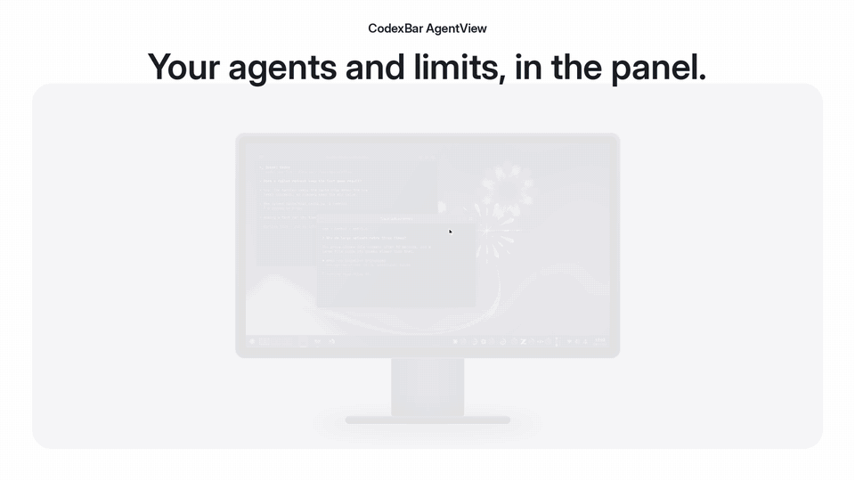
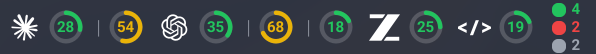
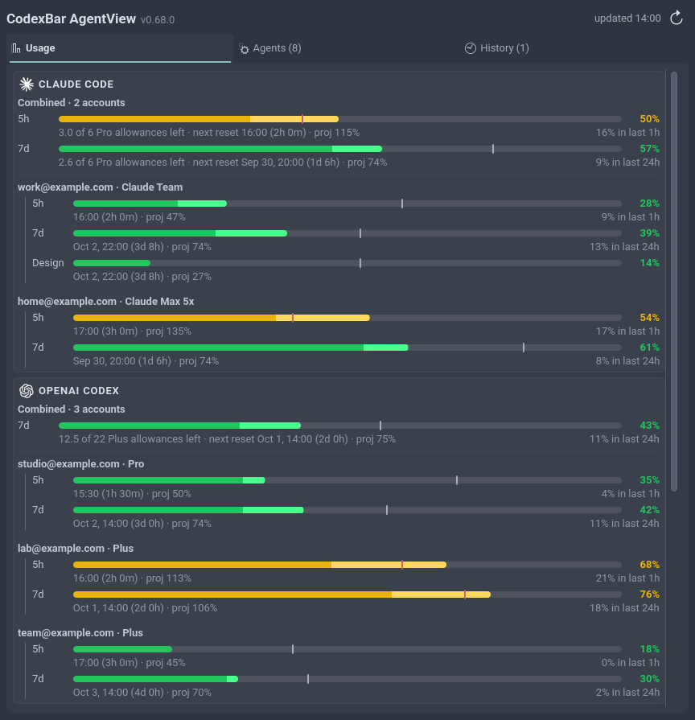
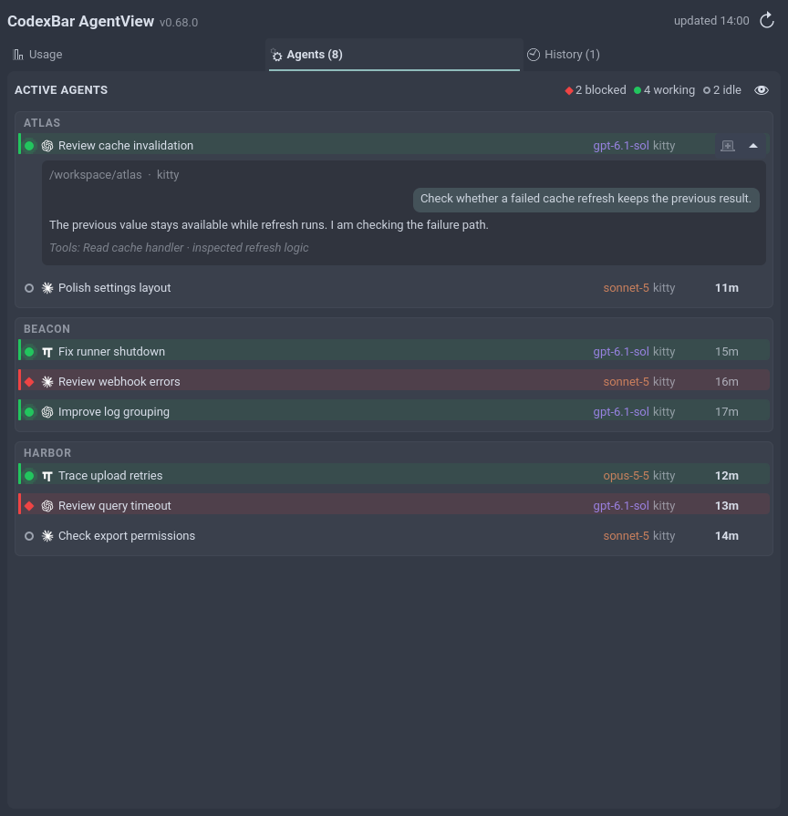
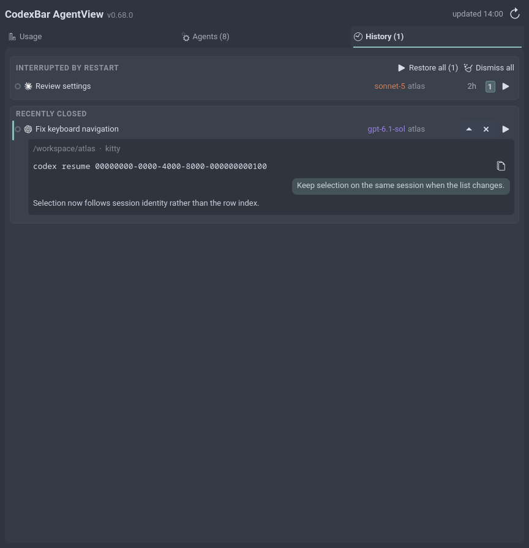

# KDE Plasma widget

The optional panel widget: usage rings and agent dots in the panel, and a
popup with the Agents, History and Usage tabs. Use it beside Tern, or on its
own if you work in other terminals. With **Tern integration** on (Settings →
Agents), its Agents list also marks set-aside sessions.



<details>
<summary>Screenshots</summary>

[](panel.png)

| Usage | Agents | History |
| :---: | :---: | :---: |
| [](plasma-usage.png) | [](plasma-agents.png) | [](plasma-history.png) |

</details>

The tabs work as the README's [Features](../README.md#features) describe; this
page covers what is Plasma's own.

- [Requirements](#requirements)
- [Install](#install)
- [Panel](#panel)
- [Plasma-only behaviour](#plasma-only-behaviour)
- [Update](#update)
- [Uninstall](#uninstall)

## Requirements

Besides Python 3.10+ and the optional tools in the README's
[Requirements](../README.md#requirements):

| Requirement | | Enables |
| --- | :---: | --- |
| KDE Plasma 6 with KWin | Required | The widget |
| CMake 3.21+, C++17 compiler, Qt 6 QML headers | Required | Building the widget (Arch: `base-devel cmake qt6-declarative`) |
| `qdbus6` | Optional | Click to focus and desktop switching |
| `notify-send` | Optional | Usage and waiting-for-input alerts |

## Install

1. Build and install. The package has a small native QML plugin, so build it
   on the machine that runs it:

   ```sh
   git clone https://github.com/materemias/codexbar-agentview
   cd codexbar-agentview
   cmake -S . -B build
   cmake --build build
   kpackagetool6 -t Plasma/Applet -i build/package
   ```

2. Right-click the panel → **Enter Edit Mode** → **Add Widgets…**, search for
   **CodexBar AgentView** and drag it onto the panel.
3. In the widget's settings, open **Agents** and click **Install**, then run
   `systemctl --user restart plasma-plasmashell.service` once. Agents and
   History stay empty until you do.
4. [Add credentials](../README.md#provider-credentials) for providers beyond
   Claude and Codex. Plasma does not see keys exported in your shell profile.

The `codexbar` path defaults to `/usr/bin/codexbar`, where Arch's
`codexbar-cli` package puts it. Change it in Settings → Backend.

The package includes the [omp extension](../README.md#omp-extension-set-aside-sessions).

Updating file associations preserves existing settings, including symlinked
configuration. A failed write leaves the original configuration intact.

## Panel

Usage rings per provider and window, coloured by pace, which you can set to
appear only once a window is projected to run out. Coloured dots count
working, blocked and idle agents. The popup opens on Agents when one is
blocked and on History when sessions wait to be restored.

With several Claude or Codex accounts, the tray settings list each account
with its own windows. A meter picked before the accounts were known (saved as
`claude:primary`) shows every account's window until you change one account,
which turns it into one meter per account
(`claude:<email>:primary`).

## Plasma-only behaviour

- **`Super+A`** opens the popup on Agents. Inside it, the keys are the ones the
  README's [Keyboard shortcuts](../README.md#keyboard-shortcuts) mark "Both".
- **Focus** switches to the session's desktop and raises its terminal.
- **Desktop alerts.** Usage warnings at 80% and 95%, or earlier when the pace
  says the window runs out before it resets, and waiting-for-input alerts
  (off by default). Alerts from one refresh arrive as one notification.
- **Track usage** (Settings → Backend) turns usage tracking off; Tern has its
  own switch.
- **Settings:** right-click the widget → **Configure CodexBar AgentView**.
  They are separate from Tern's.

## Update

Stop Plasma before replacing the native plugin; `systemctl --user stop` waits
for plasmashell to exit, `kquitapp6` does not:

```sh
git pull
cmake -S . -B build && cmake --build build
systemctl --user stop plasma-plasmashell.service
kpackagetool6 -t Plasma/Applet -u build/package
systemctl --user start plasma-plasmashell.service
```

If an update deleted files, replace the `-u` line with
`kpackagetool6 -t Plasma/Applet -r io.github.materemias.codexbaragentview`
followed by `kpackagetool6 -t Plasma/Applet -i build/package`.

### Upgrading from codexbar-kde

The widget ID changed with the rename. Point the existing panel widget at the
new package so it keeps its place and settings:

```sh
git pull
cmake -S . -B build && cmake --build build
systemctl --user stop plasma-plasmashell.service
kpackagetool6 -t Plasma/Applet -i build/package
sed -i 's/^plugin=org\.codexbar\.plasmoid$/plugin=io.github.materemias.codexbaragentview/' \
  ~/.config/plasma-org.kde.plasma.desktop-appletsrc
kpackagetool6 -t Plasma/Applet -r org.codexbar.plasmoid
systemctl --user start plasma-plasmashell.service
```

Then click widget settings → **Agents** → **Install** again.

## Uninstall

Click Settings → Agents → **Remove** if you installed the integration, then:

```sh
kpackagetool6 -t Plasma/Applet -r io.github.materemias.codexbaragentview
```
